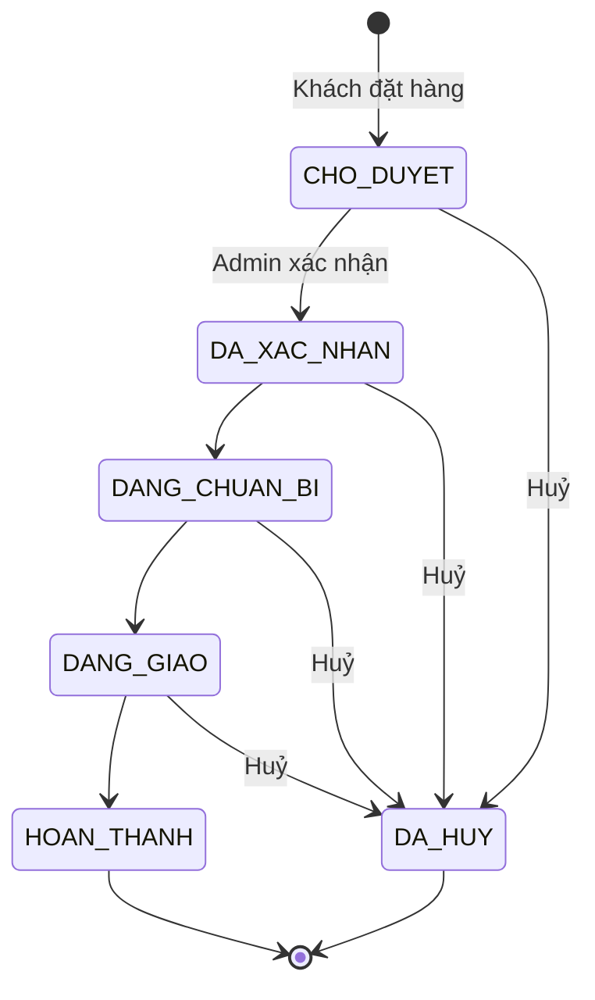
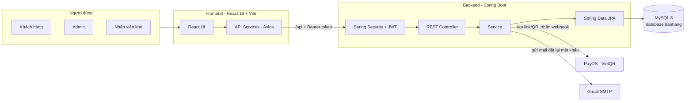

# Sales Management N6TT27

Hệ thống quản lý bán hàng cho cửa hàng điện thoại: **Spring Boot REST API + JWT**, **React 18 (Vite)**, **MySQL 8**, đóng gói bằng **Docker Compose**. Ba vai trò: khách mua hàng, nhân viên kho và admin.

> **Phiên bản:** `final_v1` — hoàn thiện các module quản trị, kho, bán hàng, thanh toán tiền thật qua PayOS/VietQR và thống kê.

## Description

### Bối cảnh

Đây là đồ án môn học **N6TT27**. Mục tiêu là số hoá quy trình bán hàng của một cửa hàng nhỏ: quản lý sản phẩm và tồn kho, cho khách đặt hàng và thanh toán COD/VietQR, để admin theo dõi đơn và doanh thu thay vì ghi sổ thủ công. Bản `final_v1` hoàn thiện toàn bộ phạm vi: quản trị người dùng, danh mục – sản phẩm – biến thể, khuyến mãi, đánh giá, kho và nhập hàng, bán hàng, **thanh toán tiền thật qua PayOS** (VietQR + webhook xác nhận), thống kê và nhập/xuất Excel.

### Vai trò

| Role | Phạm vi |
| --- | --- |
| `ROLE_ADMIN` | Toàn hệ thống: người dùng, danh mục, thương hiệu, nhà cung cấp, sản phẩm/biến thể, khuyến mãi, đánh giá, đơn hàng, kho và thống kê |
| `ROLE_CUSTOMER` | Mua sắm, giỏ hàng, đặt hàng, thanh toán, lịch sử đơn, hồ sơ cá nhân, đánh giá sản phẩm |
| `ROLE_WAREHOUSE_STAFF` | Lập phiếu nhập kho, theo dõi lịch sử nhập, tra cứu tồn kho |

### Điểm nổi bật của `final_v1`

- **Thanh toán tiền thật qua PayOS/VietQR**: tạo link/QR theo từng đơn, nhận webhook có xác thực chữ ký và đối chiếu số tiền; chống xử lý trùng bằng khoá ghi + kiểm tra idempotent.
- **Quản lý tồn kho hai lớp**: `quantity` (tồn thực tế) và `reservedQuantity` (giữ chỗ khi đặt hàng); chỉ cho bán khi `quantity - reservedQuantity` còn đủ.
- **Vòng đời đơn hàng 6 trạng thái**, chuyển một chiều, chặn nhảy cóc; tự nhả chỗ, trừ kho hoặc hoàn kho đúng một lần.
- **Quản trị đầy đủ**: CRUD người dùng, danh mục, thương hiệu, nhà cung cấp, sản phẩm, biến thể, khuyến mãi, đánh giá; duyệt đơn và duyệt phiếu nhập kho.
- **Nhập/xuất Excel**: sản phẩm, biến thể, đơn hàng và báo cáo thống kê; kết quả import báo rõ số dòng tạo mới, trùng mã và lỗi.
- **Bảo mật theo hướng ứng dụng thật**: BCrypt, JWT access/refresh token, phân quyền theo role ở cả URL lẫn method, token đặt lại mật khẩu dùng một lần.
- **Đóng gói Docker** cho cả production và dev hot-reload, kèm seed dữ liệu mẫu và bộ test backend.

### Chức năng chi tiết

#### Khách hàng (storefront)

- **Tài khoản**: đăng ký, đăng nhập, đăng xuất; quên mật khẩu nhận link qua Gmail (token 15 phút, dùng một lần).
- **Trang chủ**: banner, sản phẩm gợi ý/ngẫu nhiên, danh mục và thương hiệu.
- **Tìm kiếm**: gợi ý tức thời theo tên sản phẩm, lưu lịch sử từ khoá trên trình duyệt.
- **Lọc và phân trang**: theo danh mục, thương hiệu và 5 khoảng giá (dưới 2 triệu → trên 13 triệu).
- **Chi tiết sản phẩm**: nhiều biến thể (màu, RAM, bộ nhớ), giá và tồn kho riêng từng biến thể, ảnh, sản phẩm tương tự, điểm đánh giá và phân bố số sao.
- **Giỏ hàng**: lưu phía server, cập nhật số lượng theo tồn khả dụng, xoá từng món hoặc xoá toàn bộ.
- **Đặt hàng**: thông tin người nhận, địa chỉ, ghi chú, chọn voucher giảm giá; hỗ trợ mua từ giỏ hoặc mua ngay.
- **Thanh toán**: COD khi nhận hàng hoặc VietQR qua PayOS (mở link/QR, tải ảnh QR; trạng thái thanh toán ghi nhận qua webhook).
- **Lịch sử đơn**: lọc theo trạng thái, xem chi tiết, thanh toán tiếp đơn chưa trả, huỷ đơn khi còn ở trạng thái cho phép.
- **Hồ sơ cá nhân**: cập nhật họ tên, email, số điện thoại, địa chỉ; đổi hoặc xoá ảnh đại diện.
- **Đánh giá**: gửi số sao và nhận xét cho sản phẩm.

#### Quản trị viên (admin)

- **Dashboard**: tổng quan hệ thống và các lối tắt đến module quản trị.
- **Người dùng**: thêm, sửa, xoá, đổi vai trò, cập nhật ảnh đại diện; chặn tự xoá và không cho xoá admin cuối cùng.
- **Danh mục / thương hiệu / nhà cung cấp**: CRUD đầy đủ, tìm kiếm và phân trang.
- **Sản phẩm**: CRUD, gắn danh mục – thương hiệu – nhà cung cấp, nhập/xuất Excel.
- **Biến thể**: CRUD, upload ảnh, màu/RAM/bộ nhớ/giá, nhập/xuất Excel.
- **Khuyến mãi**: quản lý mã, tên, số tiền giảm và thời gian hiệu lực.
- **Đánh giá**: xem toàn bộ đánh giá, thêm/sửa/xoá và phản hồi khách hàng.
- **Đơn hàng**: lọc theo mã, khách hàng, trạng thái, phương thức thanh toán; xem chi tiết; chuyển trạng thái theo đúng luồng; xuất Excel; xoá đơn kèm hoàn tồn.
- **Kho hàng**: xem/sửa thông tin kho, danh sách nhân viên kho, lịch sử phiếu nhập, duyệt hoặc từ chối phiếu nhập, xem tồn kho.
- **Thống kê**: doanh thu theo ngày, số đơn theo trạng thái, top 5 sản phẩm bán chạy, danh sách tồn thấp (≤ 5), xuất Excel đơn hàng theo khoảng lọc.

#### Nhân viên kho (staff)

- **Bàn làm việc**: thống kê phiếu nhập chờ duyệt/đã duyệt/từ chối và lối tắt thao tác.
- **Lập phiếu nhập**: chọn nhà cung cấp, thêm nhiều biến thể với số lượng và giá nhập; kiểm tra giá nhập nhỏ hơn giá bán; tính tổng tiền phiếu.
- **Lịch sử nhập**: lọc theo sản phẩm/trạng thái, xem chi tiết từng phiếu và trạng thái duyệt.
- **Nhà cung cấp**: xem danh sách để chọn khi lập phiếu nhập.
- **Tồn kho**: tra cứu số lượng thực tế, số đã giữ chỗ và số còn bán được theo từng biến thể.

#### Nền tảng và kỹ thuật

- **Xác thực**: JWT access token 30 phút, refresh token 7 ngày; refresh token xoay vòng và bị thu hồi khi logout hoặc khi tài khoản bị xoá.
- **Phân quyền**: `@PreAuthorize` theo role; API đọc danh mục/sản phẩm công khai, API ghi yêu cầu admin.
- **Upload file**: ảnh biến thể và ảnh đại diện, giới hạn 10 MB, phục vụ qua `/uploads/**`.
- **API docs**: Swagger UI + OpenAPI, cấu hình Bearer token để thử API trực tiếp.
- **Kiểm thử**: 16 lớp test backend (service, repository, webhook concurrency) chạy trên H2.
- **Dữ liệu mẫu**: role, tài khoản, danh mục, sản phẩm/biến thể, kho, tồn kho, khuyến mãi và đơn hàng mẫu.

### Dữ liệu chính

Các bảng nghiệp vụ: `users`, `roles`, `refresh_tokens`, `password_reset_tokens`, `categories`, `brands`, `suppliers`, `products`, `product_variants`, `warehouses`, `inventories`, `import_receipts`, `import_details`, `carts`, `cart_items`, `orders`, `order_details`, `promotions`, `reviews`.

Quan hệ chính: sản phẩm thuộc danh mục/thương hiệu/nhà cung cấp; mỗi sản phẩm có nhiều biến thể; tồn kho gắn cặp (kho, biến thể); đơn hàng có nhiều dòng chi tiết; phiếu nhập có nhiều dòng nhập.

### Luồng nghiệp vụ chính



1. **Đặt hàng**: server kiểm tra `quantity - reservedQuantity`, cộng số lượng vào `reservedQuantity` và tạo đơn `CHO_DUYET`. Hết hàng thì rollback, không tạo đơn.
2. **Thanh toán**: COD giữ đơn chờ shop xác nhận; VietQR tạo link PayOS, webhook xác thực chữ ký + số tiền rồi đánh dấu đã trả. Đơn vẫn đi theo luồng trạng thái phía trên.
3. **Hoàn thành**: trừ `quantity` và giải phóng `reservedQuantity` đúng một lần nhờ cờ `stockDeducted`; đơn COD được đánh dấu đã thu tiền.
4. **Huỷ đơn**: nhả phần đã giữ chỗ; nếu kho đã bị trừ thì cộng trả lại. Đơn đã thanh toán được ghi chú cần hoàn tiền thủ công.
5. **Nhập kho**: nhân viên tạo phiếu `PENDING`; admin duyệt `APPROVED` thì cộng `quantity`, từ chối `REJECTED` thì không thay đổi tồn kho.

### Công nghệ

| Thành phần | Công nghệ |
| --- | --- |
| Backend | Java 21, Spring Boot 4.1.1, Spring Security + JWT (jjwt 0.11.5), Spring Data JPA/Hibernate, Validation, Spring Mail, springdoc-openapi 3.1.1, Apache POI 5.3.0 (Excel), Lombok |
| Frontend | React 18.3.1, Vite 5, Axios, FontAwesome, `qrcode.react`, `read-excel-file` / `write-excel-file` |
| Dữ liệu | MySQL 8.0 (database `banhang`), phpMyAdmin |
| Hạ tầng | Docker + Docker Compose; frontend production phục vụ bằng Nginx |

### Cấu trúc thư mục

```text
Sales-Management-N6TT27/
├── backend/            # Spring Boot API (Controller → Service → Repository)
├── frontend/           # React + Vite (pages: shop / admin / staff)
├── mermaid/            # 14 sơ đồ use-case, ERD, kiến trúc, sequence
├── docs/               # Cấu trúc hệ thống, database, JWT, PayOS idempotency
├── specs/              # Đặc tả chức năng theo từng module
├── docker-compose.yml  # Chạy production
├── docker-compose.dev.yml
└── .env.example        # Mẫu biến môi trường
```

## Badges


## Visuals

Kiến trúc tổng thể:



Sơ đồ chi tiết nằm trong thư mục [`mermaid/`](mermaid/):

| Nhóm | Tệp |
| --- | --- |
| Tổng quan | `01-use-case.mmd`, `02-erd.mmd`, `03-system-architecture.mmd` |
| Sản phẩm / biến thể | `05-use-case-quan-ly-san-pham-bien-the.mmd`, `06-erd-san-pham-bien-the.mmd`, `07-sequence-quan-ly-san-pham.mmd`, `08-sequence-quan-ly-bien-the.mmd` |
| Đơn hàng / thanh toán / kho | `04-sequence-order.mmd`, `09-use-case-ban-hang-don-hang.mmd`, `10-erd-don-hang-thanh-toan-ton-kho.mmd`, `12-sequence-dat-hang-thanh-toan.mmd`, `13-sequence-quan-ly-don-hang-admin.mmd`, `14-sequence-thong-ke-doanh-thu.mmd` |
| Xác thực | `11-sequence-xac-thuc-jwt.mmd` |

Các màn hình chính trong ứng dụng:

| Khu vực | Màn hình |
| --- | --- |
| Khách hàng | Trang chủ, chi tiết sản phẩm, giỏ hàng, thanh toán, đặt hàng thành công, lịch sử đơn, hồ sơ cá nhân |
| Admin | Dashboard, người dùng, danh mục, thương hiệu, nhà cung cấp, kho hàng, đánh giá, sản phẩm, biến thể, khuyến mãi, đơn hàng, thống kê |
| Nhân viên kho | Bàn làm việc, lịch sử nhập kho, lập phiếu nhập, danh mục tồn kho |

Tài liệu bổ sung: [`docs/Cau_truc_he_thong.md`](docs/Cau_truc_he_thong.md), [`docs/database_basic.md`](docs/database_basic.md), [`docs/Token.md`](docs/Token.md), [`docs/payos-idempotency-race.md`](docs/payos-idempotency-race.md).

> Chưa có ảnh chụp màn hình trong repo. Khi thêm ảnh, đặt vào `docs/images/` và chèn vào mục này.

## Installation

### Requirements

- **JDK 21** và Maven (hoặc dùng `./mvnw` có sẵn trong `backend/`).
- **Node 22+** và npm (chỉ cần khi chạy frontend ngoài Docker).
- **Docker** + **Docker Compose** (khuyến nghị).
- Cổng trống: `5173` (frontend), `8080` (backend), `8081` (phpMyAdmin), `3307` (MySQL).
- `openssl` để tạo JWT secret.

### Các bước cài đặt

1. Clone repo và tạo file môi trường:

   ```bash
   git clone https://github.com/Daovinh05/Sales-Management-N6TT27.git
   cd Sales-Management-N6TT27
   cp .env.example .env
   ```

2. Mở `.env`, thay `JWT_SECRET` bằng chuỗi riêng cho môi trường của bạn:

   ```bash
   openssl rand -base64 96
   ```

3. Chạy toàn bộ hệ thống bằng Docker:

   ```bash
   # Production (build image, chạy ngầm)
   docker compose up -d --build

   # Development (hot-reload backend/frontend, không cần build lại mỗi lần sửa)
   docker compose -f docker-compose.yml -f docker-compose.dev.yml up --build
   ```

   Lần đầu backend tải Maven dependencies nên có thể mất vài phút. Theo dõi bằng `docker compose logs -f backend`.

4. Mở http://localhost:5173 và đăng nhập bằng tài khoản mẫu (xem [Usage](#usage)).

### Biến môi trường

| Biến | Bắt buộc | Mô tả |
| --- | --- | --- |
| `JWT_SECRET` | Có (production) | Secret ký JWT, tối thiểu 64 byte; tạo bằng `openssl rand -base64 96` |
| `MAIL_USERNAME` | Không | Gmail gửi mail đặt lại mật khẩu |
| `MAIL_PASSWORD` | Không | **App Password** 16 ký tự của Gmail (không phải mật khẩu đăng nhập) |
| `MAIL_FROM` | Không | Địa chỉ hiển thị ở ô "From", mặc định bằng `MAIL_USERNAME` |
| `PAYOS_CLIENT_ID` | Không | Client ID kênh thanh toán PayOS |
| `PAYOS_API_KEY` | Không | API Key PayOS |
| `PAYOS_CHECKSUM_KEY` | Không | Checksum Key PayOS để xác thực webhook |
| `APP_FRONTEND_URL` | Không | URL frontend dùng cho `returnUrl`/`cancelUrl` của PayOS, mặc định `http://localhost:5173` |

Thiếu cấu hình PayOS thì luồng **COD vẫn chạy**; thiếu cấu hình mail thì chức năng quên mật khẩu qua email không gửi được.

### Chạy trực tiếp không qua Docker

Backend đọc MySQL tại `localhost:3307` (xem `backend/src/main/resources/application.properties`), nên có thể chỉ khởi động MySQL bằng Docker:

```bash
docker compose up -d mysql phpmyadmin

# Terminal 1 - backend
cd backend && ./mvnw spring-boot:run

# Terminal 2 - frontend
cd frontend && npm install && npm run dev
```

## Usage

### Địa chỉ truy cập

| Dịch vụ | URL |
| --- | --- |
| Frontend | http://localhost:5173 |
| Backend API | http://localhost:8080 (`/api/...`) |
| Swagger UI | http://localhost:8080/swagger-ui.html |
| phpMyAdmin | http://localhost:8081 (server `mysql`, database `banhang`) |
| MySQL (từ máy host) | `localhost:3307`, database `banhang`, user `root` / `banhang123` |

### Tài khoản mẫu

`DataSeeder` tự tạo các tài khoản dưới đây khi database còn trống. **Chỉ dùng cho môi trường dev**, hãy đổi mật khẩu khi triển khai thật.

| Username | Password | Role |
| --- | --- | --- |
| `admin` | `123456` | Admin |
| `customer` | `123456` | Khách hàng |
| `kho1`, `kho2` | `123456` | Nhân viên kho |

### Quy trình thao tác nhanh

- **Khách hàng**: đăng ký/đăng nhập → chọn sản phẩm và biến thể → thêm giỏ hoặc mua ngay → nhập thông tin giao hàng, chọn voucher → thanh toán COD/VietQR → theo dõi ở **Lịch sử đơn** → đánh giá sản phẩm.
- **Admin**: đăng nhập → tạo danh mục/thương hiệu/nhà cung cấp → tạo sản phẩm và biến thể → duyệt đơn hàng → duyệt phiếu nhập kho → xem **Thống kê**.
- **Nhân viên kho**: đăng nhập → **Lập phiếu nhập mới** → theo dõi trạng thái ở **Lịch sử nhập kho** → tra cứu **Danh mục tồn kho**.

### Ví dụ gọi API

```bash
# Đăng nhập, nhận access token + refresh token
curl -s http://localhost:8080/api/auth/login \
  -H 'Content-Type: application/json' \
  -d '{"username":"admin","password":"123456"}'
```

Kết quả rút gọn:

```json
{
  "token": "eyJhbGciOiJIUzUxMiJ9...",
  "refreshToken": "eyJhbGciOiJIUzUxMiJ9...",
  "type": "Bearer",
  "id": 1,
  "username": "admin",
  "email": "admin@shop.com",
  "roles": ["ROLE_ADMIN"]
}
```

Dùng token cho các API cần xác thực:

```bash
curl -s http://localhost:8080/api/orders \
  -H "Authorization: Bearer <token>"
```

Danh sách endpoint đầy đủ có trong Swagger UI. Các nhóm chính:

| Nhóm | Endpoint tiêu biểu | Quyền |
| --- | --- | --- |
| Xác thực | `POST /api/auth/register`, `/login`, `/refresh`, `/logout`, `/forgot-password`, `/reset-password` | Công khai |
| Storefront | `GET /api/storefront/products` (lọc `category`, `brand`, `price`, `search`, `page`, `size`), `/products/{code}`, `/random`, `/suggestions` | Công khai |
| Đánh giá | `GET/POST /api/storefront/products/{code}/reviews`; `GET/POST/PUT/DELETE /api/reviews` | Xem công khai, gửi cần đăng nhập, quản trị cần admin |
| Giỏ hàng | `GET/POST /api/cart`, `PUT/DELETE /api/cart/{variantCode}`, `DELETE /api/cart` | Khách đã đăng nhập |
| Đơn hàng (khách) | `POST /api/orders`, `GET /api/orders/mine`, `GET /api/orders/{code}/detail`, `POST /api/orders/{code}/payment`, `POST /api/orders/{code}/vietqr-link`, `POST /api/orders/{code}/cancel` | Chủ đơn |
| Đơn hàng (admin) | `GET /api/orders`, `GET /api/orders/{code}`, `PATCH /api/orders/{code}/status`, `DELETE /api/orders/{code}` | Admin |
| Thanh toán | `POST /api/payments/payos-webhook` | PayOS (xác thực chữ ký) |
| Sản phẩm / biến thể | CRUD `/api/products`, `/api/variants`; `GET /api/products?format=xlsx`, `GET /api/variants?format=xlsx` để xuất Excel; `POST /api/products/import`, `POST /api/variants/import` để nhập Excel | Đọc công khai, ghi admin |
| Danh mục / thương hiệu / NCC / khuyến mãi | CRUD `/api/categories`, `/api/brands`, `/api/suppliers`, `/api/promotions` | Đọc công khai, ghi admin |
| Người dùng | `GET/POST /api/users`, `PUT/DELETE /api/users/{id}`, `PUT /api/users/{id}/role`; `GET/PUT /api/users/me` | Admin / chính chủ |
| Kho (staff) | `GET/POST /api/staff/imports`, `GET /api/staff/imports/{id}`, `GET /api/staff/imports/stats` | Nhân viên kho |
| Kho (admin) | `GET/PUT /api/admin/warehouses/{id}`, `GET /api/admin/warehouses/staff`, `GET /api/admin/imports`, `PUT /api/admin/imports/{id}/status`, `GET /api/admin/warehouses/inventory` | Admin |
| Thống kê | `GET /api/admin/stats/overview`, `/revenue-by-day`, `/orders-by-status`, `/top-products` | Admin |

### Kiểm thử PayOS webhook ở local

```bash
ngrok http 8080
# Dán https://<id>.ngrok-free.app/api/payments/payos-webhook
# vào mục Webhook URL trên dashboard https://my.payos.vn
```

### Chạy test

```bash
# Backend: 16 lớp test (service, repository, webhook concurrency) chạy trên H2
cd backend && ./mvnw test

# Frontend: kiểm tra build production
cd frontend && npm run build
```

## Support

- **Lỗi khi chạy Docker**: kiểm tra `docker ps`, sau đó `docker logs sales-backend` hoặc `docker logs sales-frontend`.
- **Backend chưa lên**: lần đầu Maven tải dependencies khá lâu; xem log tới khi thấy dòng `Started SaleManagementApplication`.
- **401/403 hàng loạt**: token cũ sau khi reset database — đăng nhập lại.
- **Cổng bị chiếm**: đổi mapping trong `docker-compose.yml` hoặc dừng tiến trình đang dùng (`lsof -i :8080`).
- **Không gửi được mail**: kiểm tra đã bật 2FA và dùng App Password, không dùng mật khẩu Gmail thường.
- **PayOS không cập nhật đơn**: webhook phải trỏ tới URL public (dùng ngrok khi chạy local); kiểm tra chữ ký và số tiền trong log backend.
- **Nhập Excel lỗi**: dùng đúng file mẫu (xuất từ màn hình quản trị), kiểm tra mã danh mục/thương hiệu/NCC và kết quả trả về để biết dòng nào bị bỏ qua.
- **Ảnh không hiển thị**: kiểm tra volume `uploads-data` của backend và quyền ghi thư mục upload.
- **Tồn kho lệch**: đối chiếu `quantity` và `reservedQuantity`; đơn huỷ sẽ nhả chỗ, đơn hoàn thành mới trừ thực tế.

Mở issue tại https://github.com/Daovinh05/Sales-Management-N6TT27/issues kèm log, ảnh chụp màn hình và các bước tái hiện.

**Liên hệ trực tiếp:** Đào Văn Vinh — [daovinhgm2005@gmail.com](mailto:daovinhgm2005@gmail.com)

## Roadmap

### Đã hoàn thành trong `final_v1`

- [x] Use-case, ERD, kiến trúc, sequence diagram (`mermaid/`)
- [x] Xác thực JWT, refresh token, phân quyền, quên/đặt lại mật khẩu qua email
- [x] Quản lý người dùng, avatar, đổi vai trò, bảo vệ admin cuối cùng
- [x] Quản lý danh mục, thương hiệu, nhà cung cấp
- [x] Quản lý sản phẩm, biến thể, upload ảnh, nhập/xuất Excel
- [x] Giỏ hàng, đặt hàng, giữ chỗ tồn kho, lịch sử đơn, huỷ đơn
- [x] **Đặt hàng và thanh toán tiền thật qua PayOS/VietQR** (tạo QR, webhook xác nhận, chống xử lý trùng)
- [x] Quản lý kho, phiếu nhập, duyệt phiếu, tồn kho hai lớp
- [x] Khuyến mãi, đánh giá sản phẩm và phản hồi của admin
- [x] Dashboard thống kê doanh thu, top sản phẩm, tồn thấp, xuất Excel
- [x] Swagger UI, seed dữ liệu mẫu, 16 lớp test backend
- [x] Docker Compose cho production và dev hot-reload

### Hướng phát triển

- [ ] GitHub Actions CI (build + test tự động)
- [ ] E2E test cho luồng đặt hàng/thanh toán
- [ ] Ảnh chụp màn hình và video demo trong README
- [ ] Triển khai bản demo public

## Contributing

Mọi contribution đều được hoan nghênh. Quy trình đề xuất:

1. Tạo nhánh từ `main`: `feat/<mo-ta-ngan>`, `fix/<mo-ta-ngan>`.
2. Commit theo **Conventional Commits**, mô tả bằng tiếng Việt:
   - `feat(variant): thêm upload ảnh biến thể`
   - `fix(auth): sửa lỗi hết hạn token`
   - `docs(mermaid): cập nhật sơ đồ đặt hàng`
3. Chạy `cd backend && ./mvnw test` và `cd frontend && npm run build` trước khi mở PR.
4. Mở PR về `main`, mô tả rõ thay đổi, cách kiểm tra và ảnh chụp nếu có thay đổi UI.
5. Không commit file `.env`, `target/`, `node_modules/` hay dữ liệu cá nhân.

## Authors and acknowledgment

Nhóm **N6TT27** — những người đóng góp theo lịch sử git:

- Congvinh2005
- Đào Phúc Dân (Dao Phuc Dan)
- Đỗ Quang Anh
- Hoàng Văn Thành (hoangthanhh)
- phucnad9121
- Quanh2le5
- Đào Văn Vinh — [daovinhgm2005@gmail.com](mailto:daovinhgm2005@gmail.com)

Báo cáo cá nhân và phân công công việc nằm trong các file `README_*.md` ở thư mục gốc. Cảm ơn thầy/cô và các bạn đã góp ý trong quá trình làm đồ án.

## License

Repo chưa có file `LICENSE` và chưa công bố giấy phép. Vui lòng liên hệ Đào Văn Vinh — [daovinhgm2005@gmail.com](mailto:daovinhgm2005@gmail.com) trước khi sử dụng lại mã nguồn cho mục đích khác ngoài học tập.

## Project status

**`final_v1` — hoàn thiện.** Các luồng chính đã chạy end-to-end bằng Docker: xác thực/phân quyền, quản lý người dùng, danh mục – thương hiệu – nhà cung cấp, sản phẩm và biến thể, khuyến mãi, đánh giá, giỏ hàng, đặt hàng, **thanh toán tiền thật qua PayOS/VietQR**, quản lý kho hai lớp, thống kê và nhập/xuất Excel. Các hạng mục còn lại trong roadmap là cải tiến bổ sung (CI, E2E test, ảnh demo, triển khai public).
