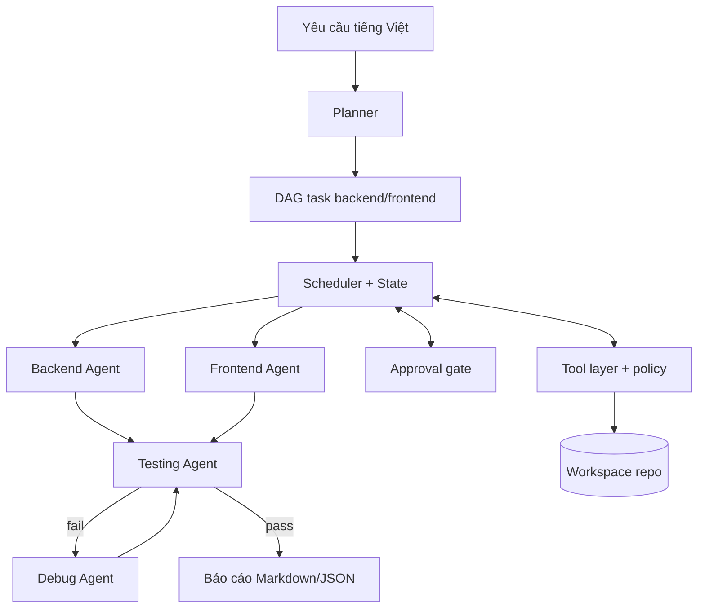
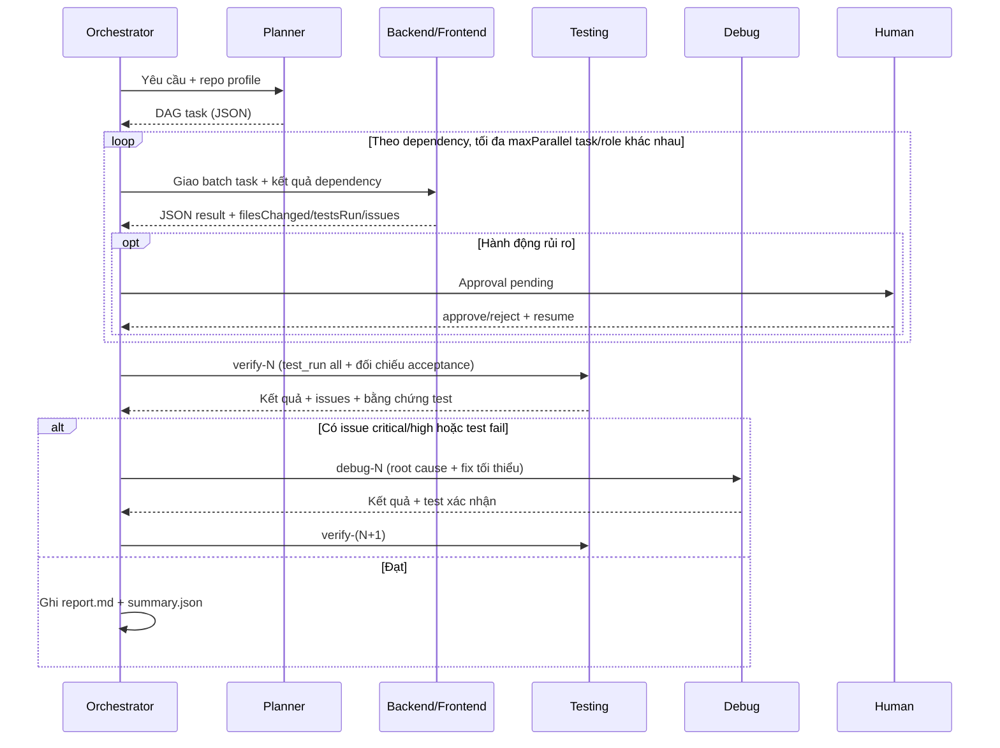

# Agent Team — 4 AI Agent phối hợp phát triển phần mềm

Orchestrator TypeScript chạy độc lập trong repo, điều phối 4 agent **Backend**, **Frontend**, **Testing**, **Debug** để biến một yêu cầu tiếng Việt thành kế hoạch, thay đổi code, bằng chứng test và báo cáo review.

- Không tự commit/push. Mọi thay đổi nằm trong working tree để con người review.
- Có approval gate cho hành động rủi ro.
- Chạy thật với mọi LLM tương thích OpenAI Chat Completions (mặc định DeepSeek).
- Có thể đổi provider/model bằng `LLM_BASE_URL`, `LLM_MODEL`, `LLM_API_KEY`; có endpoint dự phòng tùy chọn `LLM_FALLBACK_*` khi dịch vụ chính quá tải.
- Có chế độ `--mock` để smoke-test toàn bộ pipeline mà không cần API key và không sửa code.
- Scheduler mặc định chạy tuần tự (`maxParallel=1`) để tránh va chạm trên working tree dùng chung; có thể tăng `maxParallel` khi task không sửa file chung. Có dashboard realtime bằng SSE.
- Mỗi agent có báo cáo riêng trong `agents/<role>.md`; tin nhắn đội lưu ở `messages.json`.

> Trạng thái: **MVP 0.1.0**. Luồng plan → implement → verify → debug → report có test tự động. Live quality gate chỉ chấp nhận test record do `test_run` thực sự thực thi và yêu cầu đủ suite cấu hình; chế độ mock chỉ xác nhận điều phối. Có thể cấu hình endpoint failover bằng `LLM_FALLBACK_*` để tránh phụ thuộc một model.

---

## 1. Kiến trúc nhanh



Chi tiết thiết kế: [`docs/ARCHITECTURE.md`](docs/ARCHITECTURE.md) · Yêu cầu/acceptance: [`docs/SPEC.md`](docs/SPEC.md) · An toàn: [`docs/SECURITY.md`](docs/SECURITY.md).

---

## 2. Yêu cầu môi trường

| Thành phần | Bắt buộc | Ghi chú |
|---|---|---|
| Node.js | >= 20 | Đã kiểm tra với Node 22 |
| npm | Có | Cài dependency và chạy CLI |
| Git | Nên có | Theo dõi diff, quy trách nhiệm file thay đổi |
| JDK 21 | Cho backend test | `backend/mvnw.cmd` (Windows) hoặc `backend/mvnw` |
| API key LLM | Chỉ live mode | Không cần khi dùng `--mock` |

Kiểm tra nhanh:

```powershell
cd orchestrator
npm install
npm run agent -- doctor
# Kiểm tra cả kết nối LLM (cần API key):
npm run agent -- doctor --online
# Nếu chưa có key, vẫn kiểm tra được phần còn lại:
npm run agent -- doctor --mock
```

`doctor` trả exit code `1` nếu còn mục chưa sẵn sàng.

---

## 3. Cài đặt & cấu hình

### 3.1. Tạo file `.env`

```powershell
cd orchestrator
Copy-Item .env.example .env
notepad .env
```

```bash
# Bash/macOS/Linux
cd orchestrator
cp .env.example .env
${EDITOR:-nano} .env
```

Các biến được hỗ trợ:

| Biến | Mặc định | Ý nghĩa |
|---|---|---|
| `LLM_PROVIDER` | `openai` | `openai`, `opencode` hoặc `mock` |
| `LLM_BASE_URL` | `https://api.deepseek.com/v1` | Base URL OpenAI-compatible (giữ `/v1` nếu provider yêu cầu) |
| `LLM_MODEL` | `deepseek-chat` | Model dùng cho planner và 4 agent |
| `LLM_API_KEY` | — | API key; **không commit** |
| `LLM_OPENCODE_SERVER_URL` | `http://127.0.0.1:4096` | URL của OpenCode server cục bộ khi `LLM_PROVIDER=opencode` |
| `LLM_OPENCODE_USERNAME` | `opencode` | Tên Basic Auth nếu đã bật xác thực cho OpenCode server |
| `LLM_OPENCODE_PASSWORD` | — | Mật khẩu Basic Auth; **không commit** |
| `LLM_FALLBACK_BASE_URL` | — | Endpoint dự phòng OpenAI-compatible; tự dùng khi endpoint chính quá tải/mất kết nối |
| `LLM_FALLBACK_MODEL` | — | Model tại endpoint dự phòng |
| `LLM_FALLBACK_API_KEY` | — | Key riêng cho endpoint dự phòng; **không commit** |
| `LLM_TEMPERATURE` | `0.2` | Nhiệt độ sinh code |
| `LLM_MAX_TOKENS` | `4096` | Giới hạn output mỗi lần gọi |
| `LLM_TIMEOUT_MS` | `120000` | Timeout một request LLM |
| `AGENT_APPROVAL_MODE` | `gate` | `gate`, `auto`, `deny` |
| `AGENT_MAX_PARALLEL` | `1` | Số task chạy song song tối đa (1..8) |
| `ORCHESTRATOR_RUNS_DIR` | `orchestrator/runs` | Thư mục lưu run |
| `TELEGRAM_NOTIFY` | `false` | Đặt `true` để gửi trạng thái run lên Telegram |
| `TELEGRAM_BOT_TOKEN` | — | Token bot từ Telegram BotFather; không commit |
| `TELEGRAM_CHAT_ID` | — | Chat ID nhận thông báo; không commit |

Thứ tự nạp `.env`: `<workspace>/.env` rồi `orchestrator/.env`. Chỉ các biến có prefix `LLM_`, `AGENT_`, `ORCHESTRATOR_` và cờ `TELEGRAM_NOTIFY` được nạp vào môi trường agent. Telegram bot token/chat ID được đọc riêng cho notifier, không đưa vào môi trường tiến trình con. Secret khác trong `.env` của dự án (ví dụ `JWT_SECRET`) cũng không bị nạp.

#### Dùng OpenCode với Copilot Student hoặc ChatGPT Plus

OpenCode có thể đăng nhập provider bằng OAuth, nên không cần đưa token đăng nhập vào `.env`. Trong một terminal, mở OpenCode tại repository rồi chạy `/connect`, chọn GitHub Copilot hoặc OpenAI/ChatGPT và hoàn tất đăng nhập. Chạy `opencode models` để xem model khả dụng; dùng đúng tên `provider/model` ở `LLM_MODEL`. Sau đó giữ OpenCode server chạy ở terminal riêng bằng `opencode serve --port 4096`, rồi cấu hình:

```dotenv
LLM_PROVIDER=opencode
LLM_OPENCODE_SERVER_URL=http://127.0.0.1:4096
LLM_MODEL=github-copilot/<model-id>
LLM_API_KEY=
```

Với ChatGPT Plus, dùng model có prefix `openai/` nếu lệnh `opencode models` liệt kê model đó. `doctor --online` sẽ ping OpenCode qua server. Nếu model không có quyền hoặc server chưa chạy, doctor sẽ báo lỗi kết nối/model. OpenCode trả kết quả sinh văn bản; orchestrator yêu cầu model đóng gói tool call thành JSON rồi tự thực thi tool bằng runtime hiện có. Model có thể kém ổn định hơn function calling gốc nếu không tuân thủ JSON.

Để bật báo cáo Telegram, đặt trong `orchestrator/.env`:

```dotenv
TELEGRAM_NOTIFY=true
TELEGRAM_BOT_TOKEN=<token bot>
TELEGRAM_CHAT_ID=<chat id nhận tin>
```

Orchestrator gửi một tin nhắn ngắn khi run hoàn tất, thất bại, còn vấn đề, bị hủy hoặc tạm dừng chờ duyệt. Nếu gửi lỗi, kết quả run vẫn được giữ nguyên và lỗi chỉ được ghi nhận trong log. Báo cáo không chứa source code, diff đầy đủ hay transcript. `doctor` cho biết Telegram đang tắt, thiếu cấu hình hay sẵn sàng mà không in token.

### Điều khiển run qua Telegram

Build và bật bot listener trong một cửa sổ PowerShell riêng; giữ cửa sổ này mở để bot nhận lệnh:

```powershell
npm run build
node dist/cli.js telegram
```

Trong chat riêng đã cấu hình làm `TELEGRAM_CHAT_ID`, dùng `/help` để xem lệnh. Bot hỗ trợ `/run <yêu cầu>`, `/status [runId|latest]`, `/approvals [runId|latest]`, `/approve <runId> <approvalId|all>`, `/reject <runId> <approvalId|all> [lý do]` và `/resume <runId>`. Chỉ chat riêng có ID khớp cấu hình mới được phép điều khiển; tin nhắn từ chat khác bị bỏ qua. Bot không chạy đồng thời nhiều run.

Khi nhận lệnh `/run` hoặc `/resume`, bot tự gửi cập nhật khi phase, task, kết quả test hoặc quality đổi; `/status` vẫn dùng để hỏi trạng thái hiện tại bất cứ lúc nào.

Để duyệt thao tác từ Telegram, đặt `AGENT_APPROVAL_MODE=gate`; sau đó dùng `/approve` hoặc `/reject`. Nếu đặt `auto`, run tự duyệt thao tác cần approval và không cần lệnh duyệt Telegram. Luồng điều khiển không hỗ trợ hủy run đang chạy; dừng tiến trình từ cửa sổ PowerShell.

Khi đã cấu hình đủ cả ba biến `LLM_FALLBACK_*`, orchestrator tự chuyển sang endpoint dự phòng khi endpoint chính trả 408/429/502/503/504, timeout hoặc lỗi kết nối. Hai endpoint có thể dùng model và API key khác nhau; không cần bật fallback nếu chỉ muốn đổi provider thủ công.

### 3.2. `agent.config.json`

Cấu hình chính nằm ở [`agent.config.json`](agent.config.json), có JSON Schema tại [`agent.config.schema.json`](agent.config.schema.json).

Các nhóm quan trọng:

```jsonc
{
  "provider": {
    "type": "openai",
    "baseUrl": "https://api.deepseek.com/v1",
    "model": "deepseek-chat",
    "apiKeyEnv": "LLM_API_KEY",
    "temperature": 0.2,
    "maxTokens": 4096,
    "timeoutMs": 120000
  },
  "limits": {
    "maxStepsPerTask": 24,
    "maxTaskAttempts": 2,
    "maxFixCycles": 3,
    "taskTimeoutMs": 1200000,
    "maxParallel": 1,
    "maxToolOutputChars": 12000,
    "maxFileWriteBytes": 400000,
    "maxContextChars": 14000
  },
  "approval": { "mode": "gate" },
  "tests": {
    "backend": { "cwd": "backend", "command": "\"{mvnw}\" -q test" },
    "frontend": { "cwd": "frontend", "command": "npm run build" }
  }
}
```

| Giới hạn | Tác dụng |
|---|---|
| `maxStepsPerTask` | Số lượt gọi LLM tối đa cho một task (mỗi lượt có thể gồm nhiều tool call) |
| `maxTaskAttempts` | Số lần thử lại một task khi agent trả `blocked`/`failed` hoặc lỗi |
| `maxFixCycles` | Số vòng Debug tối đa sau các lần verify thất bại |
| `taskTimeoutMs` | Deadline cho một task và timeout mặc định của shell/test |
| `maxParallel` | Số task chạy song song tối đa; mặc định `1` vì các agent dùng chung working tree. Chỉ tăng khi task chắc chắn tách file; chưa có worktree/merge để cô lập thay đổi |
| `maxToolOutputChars` | Cắt output tool trước khi đưa lại cho LLM |
| `maxFileWriteBytes` | Chặn một lần ghi file quá lớn |
| `maxContextChars` | Giới hạn "bản đồ repo" trong system prompt |

Placeholder trong `tests.*.command`:

- `{mvnw}` → `backend/mvnw.cmd` trên Windows, `backend/mvnw` trên Unix (fallback `mvn`).
- `{npm}` → `npm`.
- `{workspace}` → đường dẫn workspace đã quote.

### 3.3. Thứ tự ưu tiên cấu hình

1. Giá trị mặc định trong `src/config.ts`.
2. `agent.config.json`.
3. Biến môi trường (`LLM_*`, `AGENT_APPROVAL_MODE`, `AGENT_MAX_PARALLEL`, `ORCHESTRATOR_RUNS_DIR`).
4. Tham số CLI (`--model`, `--base-url`, `--max-cycles`, `--parallel`, `--config`, `--workspace`, `--mock`, `--yes`).

---

## 4. Chạy thử

Tất cả lệnh dưới đây chạy từ `orchestrator/`.

### 4.1. Demo bốn role, không cần API key

```powershell
npm run demo
```

Demo dùng phản hồi LLM scripted offline, nhưng chạy thật các tool ghi/đọc/sửa file, gửi tin nhắn Backend ↔ Frontend và Testing ↔ Debug, cùng Node assertion test. Backend cố ý tạo sai công thức giảm giá; Testing chạy test và bắt lỗi; Debug sửa code, chạy lại test; cuối cùng sinh report tổng và report riêng từng role. Mã demo, test và báo cáo được giữ trong `runs/demo-...` để xem lại; demo không sửa source code sản phẩm và không gọi API mạng.

### 4.2. Smoke test điều phối không cần API key

```powershell
npm run agent -- run "Thêm API và màn hình quản lý nhà cung cấp" --mock --no-interactive
```

Chế độ mock:

- Không gọi mạng, không sửa file.
- Planner và 4 agent trả kết quả giả lập.
- Kiểm tra luồng state, scheduler, quality loop, report.

### 4.3. Chỉ lập kế hoạch

```powershell
npm run agent -- plan "Thêm chức năng quên mật khẩu"
# hoặc
npm run agent -- run "Thêm chức năng quên mật khẩu" --plan-only
```

Lệnh này chỉ tạo DAG, không thực thi task và không sửa code.

### 4.4. Chạy thật

```powershell
npm run agent -- run "Thêm API quản lý nhà cung cấp và màn hình danh sách" --yes
```

- Bỏ `--yes` nếu muốn được hỏi trực tiếp khi gặp hành động rủi ro.
- Dùng `--no-interactive` trong CI: hành động rủi ro sẽ tạo approval `pending` và dừng run với exit code `2`.

### 4.5. Duyệt và chạy tiếp

```powershell
npm run agent -- status latest
npm run agent -- approvals latest
npm run agent -- approve <runId> <approvalId>
npm run agent -- resume <runId>
```

Từ chối một hành động:

```powershell
npm run agent -- reject <runId> <approvalId> "Không cho phép đổi dependency"
npm run agent -- resume <runId>
```

Agent sẽ nhận lỗi policy và phải tìm cách khác; approval bị từ chối không tạo grant.

### 4.6. Xem kết quả

```powershell
npm run agent -- report latest --print
npm run agent -- report latest --open
```

### 4.7. Dashboard realtime (SSE)

Mở dashboard ở một terminal khác trong lúc run đang chạy:

```powershell
npm run agent -- serve latest --port 4317
# Mở http://127.0.0.1:4317/
```

Dashboard hiển thị trạng thái, task, luồng `events.jsonl`, tin nhắn đội và approval đang chờ.
Có thể duyệt/từ chối approval ngay trên web; sau đó chạy `resume` như bình thường.

API local (không có auth, mặc định chỉ bind `127.0.0.1`):

| Endpoint | Mục đích |
|---|---|
| `GET /health` | Health check |
| `GET /api/runs` | Danh sách run |
| `GET /api/runs/:id/state` | State JSON |
| `GET /api/runs/:id/events` | SSE replay + tail `events.jsonl` |
| `GET /api/runs/:id/report` | `report.md` |
| `GET /api/runs/:id/messages` | Tin nhắn đội |
| `GET /api/runs/:id/agents` | Danh sách báo cáo agent |
| `GET /api/runs/:id/agents/:role` | Báo cáo riêng của role |
| `POST /api/runs/:id/approvals/:approvalId/approve` | Duyệt |
| `POST /api/runs/:id/approvals/:approvalId/reject` | Từ chối |

---

## 5. CLI reference

```text
npm run agent -- <lệnh> [tham số]
```

| Lệnh | Mô tả |
|---|---|
| `run "<yêu cầu>"` (alias `start`) | Chạy plan → implement → verify → debug → report |
| `plan "<yêu cầu>"` | Chỉ lập kế hoạch |
| `resume [runId]` | Tiếp tục run đang chờ duyệt hoặc chưa xong |
| `status [runId]` | Tiến độ, task, quality, token, approval đang chờ |
| `runs` | Liệt kê các run |
| `approvals [runId]` | Chi tiết approval của run |
| `approve <runId> <id\|all>` | Phê duyệt một hoặc tất cả |
| `reject <runId> <id\|all> [lý do]` | Từ chối |
| `report [runId]` | Đường dẫn báo cáo; `--print` để in, `--open` để mở |
| `serve [runId]` | Dashboard realtime SSE + duyệt approval (`--port`, `--host`) |
| `doctor` | Kiểm tra Node, Git, API key, Java, Maven wrapper, thư mục runs |
| `help`, `version` | Trợ giúp / phiên bản |

`runId` có thể là `latest`.

### Tuỳ chọn

| Flag | Ý nghĩa |
|---|---|
| `--workspace <path>` | Repo đích (mặc định: thư mục cha của `orchestrator/`) |
| `--config <path>` | File cấu hình khác |
| `--mock` | Ép chế độ mock, không sửa code, không cần key |
| `--yes` | Tự động phê duyệt hành động rủi ro trong run này |
| `--plan-only` | Như lệnh `plan` |
| `--max-cycles <n>` | Ghi đè số vòng Debug tối đa |
| `--parallel <n>` | Ghi đè `maxParallel` (1..8) |
| `--model <name>` | Ghi đè model |
| `--base-url <url>` | Ghi đè base URL |
| `--port <n>` | Cổng dashboard khi dùng `serve` (mặc định `4317`) |
| `--host <host>` | Host dashboard khi dùng `serve` (mặc định `127.0.0.1`) |
| `--verbose` | Log debug và dữ liệu chi tiết |
| `--quiet` | Không in log ra stdout (vẫn ghi `events.jsonl`) |
| `--json` | Xuất JSON cho `status` / `runs` |
| `--print`, `--open` | Dùng với `report` |
| `--online` | Dùng với `doctor`: ping LLM thật |
| `--no-interactive` | Không hỏi trực tiếp; tạo approval pending và dừng |

### Exit code

| Code | Trạng thái |
|---|---|
| `0` | `completed` hoặc `planned` |
| `1` | `failed` hoặc lỗi CLI |
| `2` | `awaiting_approval` |
| `3` | `completed_with_issues` |

---

## 6. Quy trình chạy



### Quy tắc chất lượng

- Testing Agent phải chạy `test_run suite="all"` và trả `testsRun` thật.
- Ở live mode, **không có bằng chứng test → `blocked`**, không được coi là đạt.
- Test fail tự sinh issue `high`.
- Chỉ issue `critical`/`high` chặn hoàn thành; `medium`/`low` được ghi lại và có thể vẫn `done`.
- `quality.passed = true` chỉ khi Testing trả `status=done`, không còn issue blocking và có bằng chứng test.
- Số vòng Debug tối đa là `maxFixCycles` (mặc định 3). Hết vòng → `completed_with_issues`.
- Không sửa/xoá test để làm xanh; Debug phải tái hiện lỗi trước khi sửa.

### Trạng thái task

`pending` → `ready` → `in_progress` → `done` | `failed` | `blocked` | `skipped` | `needs_approval`

Task do orchestrator sinh ra (`verify-*`, `debug-*`) có `generatedBy: "engine"` và không bị skip theo dependency, để vẫn có chẩn đoán khi implementation lỗi.

### Trạng thái run

`initializing` → `planning` → `planned` / `running` → `awaiting_approval` → `completed` / `completed_with_issues` / `failed`

---

## 7. Công cụ agent được dùng

| Tool | Mục đích | Gate |
|---|---|---|
| `fs_list` | Liệt kê file/thư mục | Deny path bảo vệ |
| `fs_read` | Đọc file text theo khoảng dòng | Deny path bảo vệ |
| `fs_write` | Ghi toàn bộ file | Deny path bảo vệ; cho phép trong workspace |
| `fs_edit` | Thay đúng một đoạn text | Deny path bảo vệ |
| `fs_search` | Regex trong file | Deny path bảo vệ |
| `shell_run` | Chạy **một** lệnh, không nối lệnh, không `cd` | Allowlist + deny/ask pattern |
| `git_status`, `git_diff` | Đọc trạng thái/diff | Read-only, không cần duyệt |
| `test_run` | Chạy suite backend/frontend/all | Theo policy của lệnh test |
| `team_send`, `team_read` | Trao đổi giữa các agent qua `messages.json` | Không |

Mọi tool đều nhận đường dẫn tương đối trong workspace; đường dẫn tuyệt đối vẫn bị kiểm tra sandbox.

---

## 8. An toàn

Các lớp bảo vệ chính:

- **Path sandbox**: mọi thao tác file phải nằm trong `workspace`; `.env`, `*.pem`, `*.key`, `docs/Token.md`, `.git`, `node_modules`, `target`, `dist`, `orchestrator/runs` bị chặn.
- **Shell policy**: allowlist executable; chặn `git push`, `reset --hard`, `clean -f`, `rm -rf`, `deploy`, `publish`, `node -e`, command substitution, nối lệnh, `cd`.
- **Approval gate**: `git add/commit/checkout/...`, `npm install`, `npx`, `docker`, redirect output, executable ngoài allowlist cần duyệt.
- **Mode**: `gate` (mặc định), `auto` (tự duyệt), `deny` (chặn cứng mọi hành động cần duyệt, kể cả `--yes`).
- **Grant một lần**: duyệt đúng `(taskId, tool, argsHash)` và chỉ dùng một lần; resume sẽ tiêu thụ grant.
- **Secret hygiene**: không nạp secret ngoài prefix cho phép; redact key/JWT/Bearer/password trong log, transcript, approval.
- **Không commit/push**: agent bị chặn; con người tự review diff và commit.
- **Giới hạn tài nguyên**: số bước, số lần thử, timeout task, timeout shell, kích thước output/file.

Đọc thêm threat model và khuyến nghị: [`docs/SECURITY.md`](docs/SECURITY.md).

> Lưu ý: đây là sandbox mức ứng dụng, **không phải container**. Chỉ chạy trên repo tin cậy, review prompt/kế hoạch và diff trước khi merge.

---

## 9. Output của một run

Mặc định: `orchestrator/runs/<runId>/`

```text
runs/<runId>/
├── state.json                 # trạng thái máy đọc (nguồn sự thật)
├── request.md                 # yêu cầu + snapshot cấu hình đã che secret
├── tasks.md                   # bảng task dễ đọc
├── events.jsonl               # nhật ký sự kiện
├── messages.json              # tin nhắn giữa các agent
├── transcripts/<task>.jsonl   # hội thoại LLM + tool call của từng task
├── artifacts/<task>-result.json
├── agents/<role>.md           # báo cáo riêng backend/frontend/testing/debug
├── report.md                  # báo cáo tiếng Việt cho con người
└── summary.json               # tóm tắt cho CI/tooling
```

`report.md` gồm: tóm tắt điều hành, kế hoạch & tiến độ, kết quả từng task, báo cáo riêng theo agent, vòng kiểm thử, issue còn tồn tại, approval, thay đổi & cách review, token/chi phí, đề xuất tiếp theo.

Run dir và log không được commit (đã nằm trong `.gitignore`).

---

## 10. Phát triển orchestrator

```powershell
cd orchestrator
npm run typecheck     # tsc --noEmit
npm test              # vitest run (49 test)
npm run build         # xuất dist/
npm run agent -- ...  # chạy trực tiếp bằng tsx
```

Sau khi `npm run build`:

```powershell
node dist/cli.js --help
# hoặc cài như CLI toàn cục trong repo:
npm link
agent-team --help
```

Test hiện dùng LLM giả lập/scripted, không gọi API thật. Test approval dùng repo git tạm.

Cấu trúc chính:

```text
src/
├── cli.ts                 # CLI, doctor, report, approve/reject, serve
├── config.ts              # merge config + .env whitelist
├── server.ts              # dashboard SSE + API approval/báo cáo
├── agents/
│   ├── base.ts            # vòng lặp ReAct, parse JSON, transcript
│   ├── planner.ts         # planning + heuristic fallback
│   └── prompts.ts         # system prompt 4 role + output contract
├── core/
│   ├── engine.ts          # scheduler, retry, quality loop, pause/resume
│   ├── plan.ts            # validate DAG, topological sort, task state
│   ├── approvals.ts       # approval gate + grant một lần
│   ├── policy.ts          # path/shell policy
│   ├── state.ts           # run state, list/load/save
│   ├── reporter.ts        # report.md + summary.json
│   ├── context.ts         # repo profile cho prompt
│   ├── bus.ts             # message bus
│   └── git.ts             # snapshot/diff/status
├── tools/                 # fs, shell, test, team tools
├── llm/                   # OpenAI-compatible + OpenCode server + mock
└── util/                  # logger, fs, text, errors
```

---

## 11. Troubleshooting

| Triệu chứng | Cách xử lý |
|---|---|
| `thiếu LLM_API_KEY` | Điền `LLM_API_KEY` trong `orchestrator/.env`; với OpenCode, chọn `LLM_PROVIDER=opencode`; hoặc chạy `--mock` |
| `OpenCode ... fetch failed` / `ECONNREFUSED` | Khởi động OpenCode server bằng `opencode serve --port 4096`, kiểm tra URL và model bằng `opencode models` |
| `doctor` báo Java/Maven lỗi | Cài JDK 21; kiểm tra `backend/mvnw.cmd`; backend test cần Java trên PATH |
| Frontend build lỗi | Chạy `cd frontend; npm install` trước, kiểm tra `npm run build` thủ công |
| Run dừng `awaiting_approval` | `approvals <runId>` → `approve/reject` → `resume <runId>` |
| Agent báo `BỊ CHẶN BỞI POLICY` | Hành động nằm ngoài allowlist hoặc path bị bảo vệ; không nên lách, hãy đổi cách làm hoặc cấu hình phù hợp |
| Planner trả kế hoạch heuristic | LLM trả JSON sai 2 lần; xem `events.jsonl`, kiểm tra model/key, review kỹ phạm vi task |
| Test fail nhưng agent báo done | Kiểm tra mục "Vấn đề còn tồn tại" trong report; live mode yêu cầu bằng chứng test |
| Diff lẫn thay đổi cũ | Commit/stash trước khi chạy; `state.git.dirtyAtStart` cảnh báo điều này |
| Tiếng Việt bị lỗi khi xem bằng PowerShell | Dùng `Get-Content -Encoding utf8` hoặc mở bằng editor UTF-8 |

---

## 12. Giới hạn đã biết & roadmap

**Hiện tại**

- Scheduler chạy tuần tự mặc định. Có thể tăng `maxParallel` để backend và frontend chạy đồng thời khi task tách file; chưa dùng worktree/merge tự động.
- Chưa kiểm thử live với API key thật trong repo này (mới mock + scripted LLM).
- Không tự commit/push/merge (theo thiết kế).
- Không có web-search/browser tool; agent chỉ đọc repo và chạy lệnh trong allowlist.
- `reporter.aiSummary` là trường dành cho tương lai; báo cáo hiện cố định tiếng Việt.
- Repo profile được chụp đầu run, không tự cập nhật sau mỗi thay đổi.
- Chưa có sandbox OS/container; phụ thuộc policy mức ứng dụng.
- Chưa có merge conflict resolution hay rollback tự động.
- Dashboard local không có auth; chỉ dùng trên máy tin cậy.

**Roadmap**

1. Worktree/merge tự động cho task cùng role và file dùng chung.
2. Thêm tool `fs_delete` có approval, `db_query` read-only, `http_request` có allowlist domain.
3. Sandbox container/VM cho shell và giới hạn network.
4. Tích hợp CI: `--no-interactive`, `summary.json`, exit code.
5. Đo chi phí theo model, cache prompt, nén context.
6. Chat hai chiều thời gian thực giữa agent (hiện là mailbox file-backed + dashboard poll).
7. Golden tests cho planner và regression benchmark trên repo mẫu.

---

## 13. Liên kết

- [Kiến trúc chi tiết](docs/ARCHITECTURE.md)
- [Đặc tả & acceptance](docs/SPEC.md)
- [An toàn & threat model](docs/SECURITY.md)
- [Tổng quan đội agent ở root repo](../AI_AGENT_TEAM.md)
- [Constitution dự án](../.specify/memory/constitution.md)
