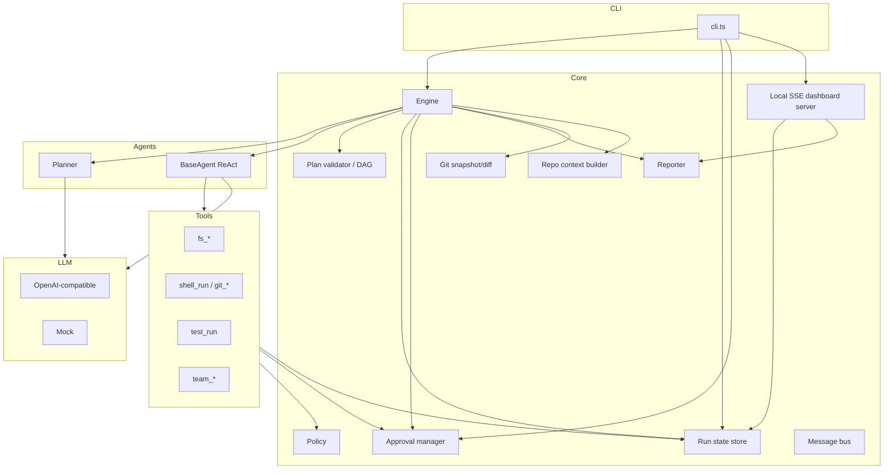
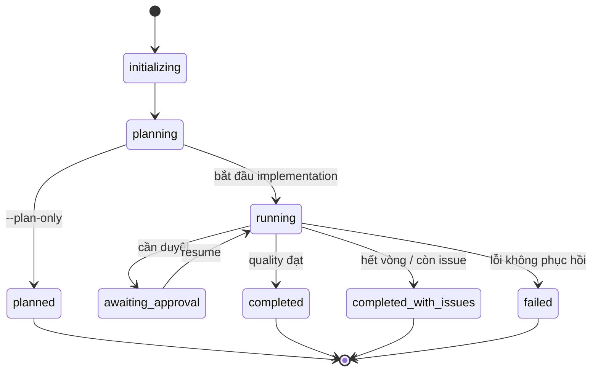
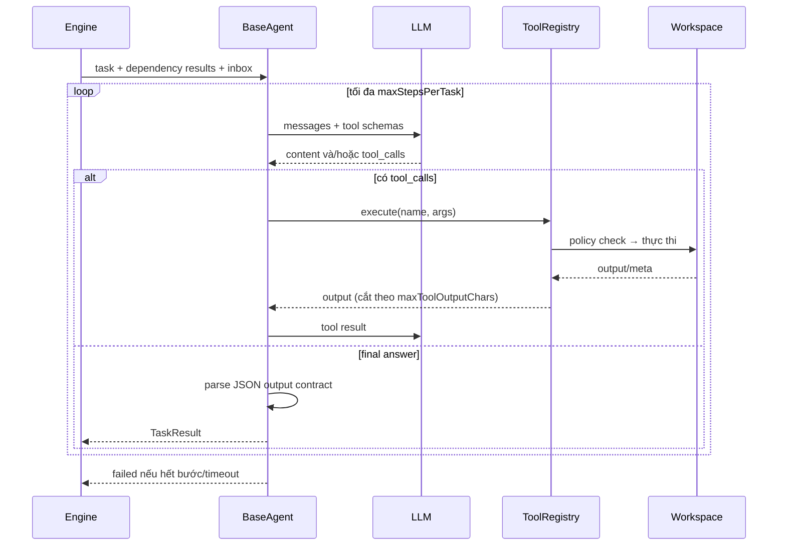
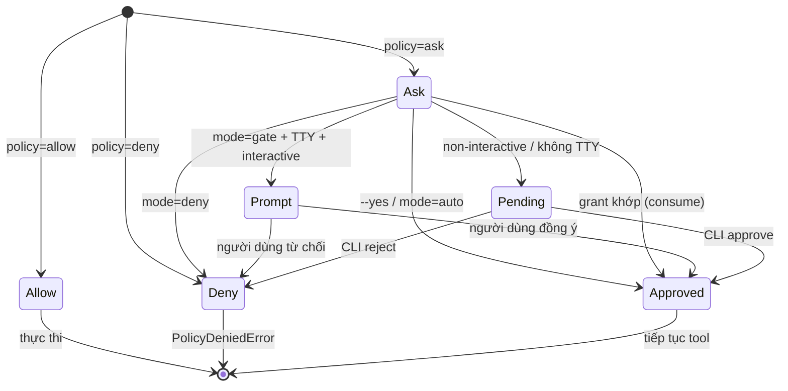
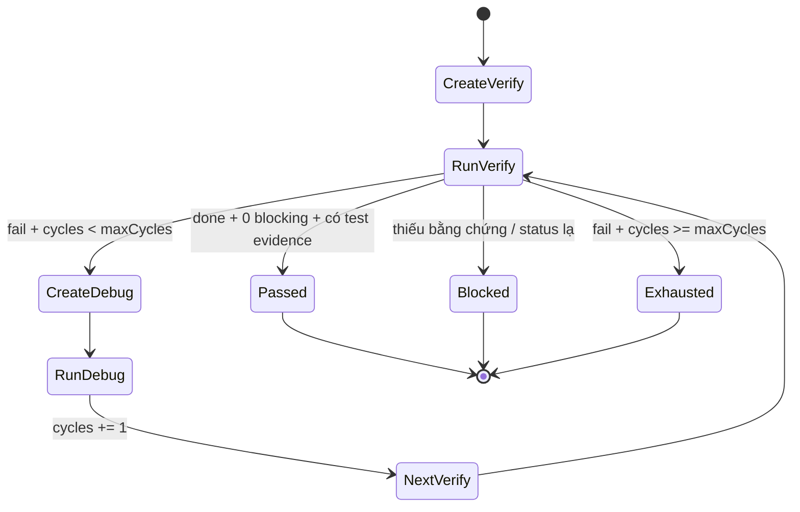

# Kiến trúc Orchestrator — Agent Team

Tài liệu này mô tả thiết kế hiện tại của `orchestrator/` (MVP 0.1.0): thành phần, luồng chạy, state, scheduler, giao thức tool, approval, quality loop và các điểm mở rộng.

---

## 1. Mục tiêu & phi mục tiêu

### Mục tiêu

1. Nhận yêu cầu phần mềm bằng tiếng Việt và tự phân rã thành các task backend/frontend có dependency rõ ràng.
2. Điều phối 4 vai trò agent: **backend**, **frontend**, **testing**, **debug**.
3. Tự động chạy vòng **test → debug → test lại** có giới hạn, dừng khi đạt hoặc hết ngân sách.
4. Có **approval gate** cho hành động rủi ro; có thể tạm dừng, duyệt/từ chối, rồi resume.
5. Lưu state bền vững, có thể resume sau khi dừng; xuất báo cáo Markdown/JSON.
6. Không tự commit/push; thay đổi nằm trong working tree.
7. Chạy được trên Windows và Unix, với Node 20+, không phụ thuộc framework nặng.

### Phi mục tiêu (MVP)

- Không phải nền tảng multi-tenant hay chạy phân tán.
- Không tự merge, rollback, tạo PR hay quản lý conflict.
- Không sandbox bằng container/VM.
- Không đảm bảo correctness của code do LLM sinh ra; con người vẫn là người review cuối.
- Chưa chạy song song hai task cùng role hoặc hai task có thể sửa cùng file; hiện chạy song song theo role (backend/frontend) trong một process.

---

## 2. Nguyên tắc thiết kế

| Nguyên tắc | Cách thể hiện |
|---|---|
| **State là nguồn sự thật** | Mọi bước ghi `state.json`; CLI đọc lại state để status/resume/approve |
| **Deterministic ở lớp điều phối** | Planner/agent dùng LLM, nhưng scheduler, validation, policy, quality gate là code thường |
| **Tối thiểu quyền** | Tool layer kiểm tra path/shell trước khi thực thi; deny mặc định với secret |
| **Con người ở vòng lặp** | Hành động rủi ro tạo approval; không tự commit/push |
| **Bằng chứng thay vì lời nói** | Testing phải trả `testsRun` thật; engine tự kiểm tra lại; file thay đổi được đối chiếu bằng git snapshot khi batch chỉ có một task, còn khi chạy song song dùng tool/agent báo cáo + git status/diff cuối run |
| **Có thể dừng và tiếp tục** | Mọi trạng thái task/approval được serialize; resume không chạy lại task đã xong |
| **Giới hạn rõ ràng** | Số bước, số attempt, timeout, kích thước output/file, số vòng fix |
| **Provider-agnostic** | Chỉ phụ thuộc OpenAI Chat Completions; mock thay thế được |

---

## 3. Thành phần



### Module map

| File | Trách nhiệm |
|---|---|
| `src/cli.ts` | Parse lệnh/flag, tạo run, gọi Engine, status/runs/approvals/approve/reject/report/serve/doctor |
| `src/server.ts` | Dashboard local SSE, state/report/messages API, duyệt/từ chối approval |
| `src/config.ts` | Merge default → JSON → env → CLI; nạp `.env` có whitelist; resolve workspace; redacted config |
| `src/types.ts` | Toàn bộ kiểu dữ liệu domain |
| `src/agents/planner.ts` | Gọi LLM 2 lần, validate plan, fallback heuristic |
| `src/agents/prompts.ts` | System prompt 4 role, quy tắc chung, output contract JSON |
| `src/agents/base.ts` | Vòng lặp ReAct: gọi LLM → tool calls → tool results → final JSON; transcript/artifact |
| `src/core/engine.ts` | Scheduler implementation, retry, quality loop, pause/resume, final status, report |
| `src/core/plan.ts` | Chuẩn hoá/validate plan, topo sort, cycle detection, `recomputeReady`, chọn batch song song, engine task |
| `src/core/state.ts` | Tạo/đọc/ghi/liệt kê run; atomic write |
| `src/core/approvals.ts` | Gate `allow/ask/deny`, prompt, pending approval, grant một lần |
| `src/core/policy.ts` | `classifyShell`, `classifyPath` |
| `src/core/reporter.ts` | `report.md` + `summary.json` + `agents/<role>.md` |
| `src/core/context.ts` | Repo profile cho prompt (git, tree, manifest, constitution, test commands) |
| `src/core/bus.ts` | Message bus giữa các agent (`messages.json`) |
| `src/core/git.ts` | Git info/status/diff/snapshot, command existence |
| `src/tools/*` | Định nghĩa tool + thực thi |
| `src/llm/openai.ts` | HTTP client OpenAI-compatible, retry/backoff/timeout |
| `src/llm/mock.ts` | LLM giả lập cho smoke test |
| `src/util/*` | Logger, fs helpers, text/JSON/redaction, errors |

---

## 4. Vòng đời một run



### Luồng chạy (song song theo role)

1. **Khởi tạo**
   - Resolve workspace, load config, khởi tạo LLM (fail sớm nếu thiếu key).
   - Đọc git info; cảnh báo nếu working tree đang dirty.
   - Tạo run ID dạng `run-YYYYMMDD-HHmmss-xxxx`.
   - Tạo `runs/<id>/{transcripts,artifacts}`, ghi `request.md` (config đã redact) và `state.json`.

2. **Planning**
   - `Planner.createPlan(request)` gọi LLM với repo profile, temperature thấp.
   - Validate: tối đa 12 task, role chỉ backend/frontend, id duy nhất, title/description bắt buộc, dependency tồn tại, không cycle.
   - Nếu sai: gửi lại lỗi cho LLM sửa (tối đa 2 lần). Nếu vẫn sai: dùng **heuristic plan** tối thiểu (1 backend + 1 frontend, hoặc chỉ một bên theo từ khóa).
   - `--plan-only`: dừng ở `planned`, vẫn ghi report.

3. **Implementation**
   - Lặp: `recomputeReady` → `selectReadyTasks` chọn batch tối đa `maxParallel`, mỗi role một task → chạy batch với retry.
   - Task xong: lưu result, filesChanged, testsRun, issues. Khi batch chỉ có một task, snapshot git trước/sau để phát hiện file thay đổi thực tế; khi chạy song song, dùng tool/agent báo cáo và git status/diff cuối run.
   - Nếu task cần approval: đánh dấu `needs_approval`, giảm lại attempts, pause sau khi batch hiện tại kết thúc.
   - Nếu hết task ready nhưng còn `pending` (dependency kẹt): đánh dấu `skipped` với `blockedBy`.
   - Nếu có `needs_approval`: pause.
   - Implementation **không dừng toàn run** khi một task fail; quality loop vẫn chạy để chẩn đoán.

4. **Quality loop**
   - Tạo `verify-1` (role testing) phụ thuộc tất cả task implementation.
   - Testing chạy test suite, đọc diff, đối chiếu acceptance, trả issues.
   - Engine đánh giá độc lập (không tin hoàn toàn lời agent):
     - `status != done` → chưa đạt.
     - Không có `testsRun` ở live mode → `blocked`.
     - Mỗi test fail → thêm issue `high`.
     - Còn issue critical/high → chưa đạt.
   - Nếu chưa đạt và còn ngân sách: tạo `debug-N`, giao issues + output test.
   - Debug xong: tăng `quality.cycles`, tạo `verify-(N+1)`.
   - Đạt → `quality.passed = true`; hết vòng → `passed = false`.

5. **Kết thúc**
   - `finalStatus()`:
     - `quality.passed === true` → `completed`.
     - Tất cả task planner đều không `done` → `failed`.
     - Còn lại → `completed_with_issues`.
   - Ghi `tasks.md`, `report.md`, `summary.json`, `agents/<role>.md`; cập nhật `reportPath`.

### Resume

`Engine.resume()`:

- Chuyển `needs_approval` → `ready`, xóa `approvalId`/`error`.
- `recomputeReady`, rồi tiếp tục implementation nếu còn task planner chưa terminal.
- Nếu implementation đã xong, vào quality loop; quality loop có thể tiếp tục từ `currentVerifyId` / `currentDebugId`.
- Task đã `done` không chạy lại.

---

## 5. State model

`state.json` (rút gọn):

```jsonc
{
  "version": 1,
  "id": "run-20261019-210310-3674",
  "request": "Thêm API và màn hình quản lý nhà cung cấp",
  "workspace": "D:\\Sales-Management-N6TT27",
  "mode": "live",
  "status": "running",
  "phase": "verification",
  "createdAt": "2026-10-19T14:03:10.000Z",
  "updatedAt": "2026-10-19T14:05:20.000Z",
  "plan": {
    "summary": "...",
    "assumptions": ["..."],
    "risks": ["..."],
    "tasks": [{ "id": "be-1", "role": "backend", "dependsOn": [] }],
    "source": "llm"
  },
  "tasks": [
    {
      "id": "be-1",
      "title": "...",
      "role": "backend",
      "description": "...",
      "acceptance": ["..."],
      "dependsOn": [],
      "status": "done",
      "attempts": 1,
      "generatedBy": "planner",
      "filesChanged": ["backend/src/..."],
      "result": {
        "status": "done",
        "summary": "...",
        "filesChanged": ["..."],
        "testsRun": [{ "suite": "backend", "passed": true, "exitCode": 0 }],
        "issues": [],
        "nextSteps": []
      },
      "transcriptPath": "runs/<id>/transcripts/be-1.jsonl"
    }
  ],
  "approvals": [],
  "grants": [],
  "usage": { "calls": 12, "promptTokens": 34567, "completionTokens": 4567 },
  "quality": {
    "cycles": 1,
    "maxCycles": 3,
    "passed": false,
    "history": [
      {
        "cycle": 1,
        "verifyTaskId": "verify-1",
        "debugTaskId": "debug-1",
        "passed": false,
        "issueCount": 2,
        "blockingIssues": 1,
        "summary": "...",
        "at": "..."
      }
    ]
  },
  "git": {
    "isRepo": true,
    "branch": "feat/ai_agent",
    "commit": "e3a9cd2",
    "dirtyAtStart": false,
    "status": ""
  },
  "reportPath": "runs/<id>/report.md"
}
```

### Trạng thái task

| Trạng thái | Ý nghĩa |
|---|---|
| `pending` | Chưa đủ dependency |
| `ready` | Sẵn sàng chạy |
| `in_progress` | Đang chạy |
| `done` | Hoàn thành, acceptance được xác nhận |
| `failed` | Đã thử hết attempt nhưng lỗi |
| `blocked` | Không thể tiếp tục do môi trường/quyền/thông tin |
| `skipped` | Dependency fail/không hoàn thành |
| `needs_approval` | Đang chờ con người duyệt để tiếp tục |

`isTerminal = done | failed | blocked | skipped`.

### Quy ước trường

- `generatedBy: "planner"` — task do Planner sinh ra (backend/frontend).
- `generatedBy: "engine"` — task `verify-*` / `debug-*` do engine sinh ra.
- `testRound` — vòng verify/debug (1-based).
- `blockedBy` — dependency khiến task bị skip.
- `attempts` — số lần đã thực sự chạy; lần bị approval pause được hoàn lại.
- `filesChanged` — hợp nhất báo cáo của agent + tool meta + diff snapshot git.

---

## 6. Scheduler & DAG

### Validation

`validatePlan` chuẩn hoá id bằng `slugify`, đảm bảo duy nhất; map dependency theo id gốc; loại self-dependency; kiểm tra dependency tồn tại; `findCycle` bằng DFS; `topoSort` theo priority.

Planner chỉ được tạo role `backend`/`frontend`. Testing/debug do engine sinh sau, nên không thể có plan "tự nhận đã test xong".

### `recomputeReady`

Lặp đến khi ổn định:

- Bỏ qua task `generatedBy: "engine"` (verify/debug luôn `ready`).
- Với task planner ở `pending`/`ready`/`skipped`:
  - Nếu có dependency `failed|skipped|blocked` → `skipped`, ghi `blockedBy`.
  - Nếu tất cả dependency `done` → `ready`.
  - Ngược lại → `pending`.

### Chọn task

`selectReadyTasks` chọn tối đa `limits.maxParallel` task `ready` theo priority, nhưng **mỗi role tối đa một task/batch**. Vì vậy backend và frontend có thể chạy đồng thời; hai task backend (hoặc hai task có thể sửa cùng file) vẫn phải chạy lần lượt. Đây là song song trong một process, chưa có lock đa tiến trình hay worktree.

Khi một task cần approval, các task đang chạy trong batch được hoàn tất attempt hiện tại; scheduler dừng nhận batch mới và đưa task `in_progress` dở về `ready` trước khi pause.

### Retry

Với mỗi task:

1. `attempts += 1`, status `in_progress`.
2. Chạy agent.
3. Nếu agent trả `done` → kết thúc.
4. Nếu `blocked`/`failed` và còn attempt → retry, truyền `error`/issues làm feedback trong prompt lần sau.
5. Nếu exception:
   - `ApprovalRequiredError` → `needs_approval`, hoàn lại attempt, pause.
   - Exception khác → retry; hết attempt → `failed` + issue `high`.
6. Guard 500 vòng để tránh scheduler loop vô hạn khi chạy batch song song.

Timeout task được kiểm tra trước mỗi bước LLM; shell/test có timeout riêng.

---

## 7. Agent loop (ReAct)

Mỗi agent là một `BaseAgent` cấu hình theo role.



### Prompt

System prompt gồm:

1. Vai trò + chuyên môn + ràng buộc kiến trúc (Spring layered, React services, tiếng Việt, test là bằng chứng).
2. Quy tắc chung: đọc trước khi sửa, thay đổi tối thiểu, không secret, không commit/push, không bịa test.
3. Hướng dẫn tool (sinh từ registry).
4. Repo profile.
5. Output contract JSON.

User prompt gồm:

- Task JSON (id, title, role, description, acceptance, dependsOn, filesHint, round).
- Run ID/workspace/attempt.
- Kết quả các task dependency (summary, files, issues).
- Tin nhắn chưa đọc từ `team_send`.
- Feedback của lần thử trước (nếu có).
- Git status hiện tại.

### Output contract

```json
{
  "status": "done | blocked | failed",
  "summary": "...",
  "filesChanged": ["..."],
  "testsRun": [
    { "suite": "backend", "command": "...", "passed": true, "exitCode": 0, "outputTail": "..." }
  ],
  "issues": [
    { "severity": "critical|high|medium|low", "title": "...", "detail": "...", "file": "...", "line": 0, "repro": "...", "suspectedCause": "..." }
  ],
  "nextSteps": ["..."],
  "notes": "..."
}
```

Parse an toàn:

- Thử tách JSON trong fenced block và JSON lẫn văn xuôi; ưu tiên object cuối.
- Nếu không parse được: coi như `done` nhưng thêm issue `low` và `parseWarning` (không làm mất kết quả task).
- `filesChanged`/`testsRun` được hợp nhất với dữ liệu tool đã thu thập; test dedupe theo `(suite, command, passed)`.
- Severity lạ → `medium`.
- Summary rỗng → lấy 500 ký tự nội dung cuối.

### Transcript & artifact

- `transcripts/<task>.jsonl`: mỗi dòng là một record (`task_start`, `messages`, `assistant`, `tool`, `approval_required`, `result`), secret được redact.
- `artifacts/<task>-result.json`: TaskResult cuối cùng (nếu có final answer).
- `onUsage` cộng token vào run state sau mỗi lần gọi LLM.

---

## 8. Tool layer & giao thức

### Đăng ký

`ToolRegistry` nhận danh sách `ToolDefinition`:

```ts
interface ToolDefinition {
  name: string;
  description: string;
  parameters: Record<string, unknown>; // JSON Schema
  execute(args, context): Promise<{ ok, output, meta? }>;
}
```

- Schema được gửi cho LLM dưới dạng OpenAI function tools.
- `describeForPrompt()` sinh mô tả ngắn cho system prompt.
- Khi execute:
  - Tool không tồn tại → output lỗi, không crash.
  - JSON args sai → output lỗi hướng dẫn gọi lại.
  - `PolicyDeniedError` → trả `BỊ CHẶN BỞI POLICY` cho agent.
  - `ApprovalRequiredError` → ném lên engine để pause run.
  - Lỗi khác → trả output lỗi cho agent.

### Meta

Tool có thể trả `meta.filesChanged` và `meta.testsRun`. `BaseAgent` thu thập các meta này độc lập với lời khai cuối của agent, rồi engine hợp nhất với git snapshot. Đây là cơ chế chống "báo cáo không trung thực".

### Danh sách tool

| Tool | Read/Write | Ghi chú |
|---|---|---|
| `fs_list`, `fs_read`, `fs_search` | Read | Bỏ qua path deny; giới hạn số file/kết quả |
| `fs_write`, `fs_edit` | Write | Giới hạn byte; kiểm tra path; ghi atomic? (fs_write ghi trực tiếp) |
| `shell_run` | Execute | Một lệnh, không nối, không `cd`, cwd trong workspace |
| `git_status`, `git_diff` | Read | Không thay đổi repo |
| `test_run` | Execute | Chạy suite cấu hình, trả record PASS/FAIL + exit code |
| `team_send`, `team_read` | Bus | Tin nhắn lưu `messages.json` |

`fs_write` hiện ghi trực tiếp bằng `fs.writeFileSync` sau khi kiểm tra policy; không có ghi atomic cho file source (khác với `state.json`).

---

## 9. Policy & approval

### Path policy

`classifyPath`:

1. Resolve absolute (tương đối theo workspace).
2. Ngoài workspace → `deny`.
3. Có segment `.git` → `deny`.
4. Khớp `workspace.protectedPaths` → `deny`.
5. Ngoài `allowedRoots` → `ask`.
6. Còn lại → `allow`.

`fs_list`/`fs_search` bỏ qua entry bị deny thay vì dừng toàn bộ.

### Shell policy

`classifyShell` theo thứ tự:

1. Rỗng, newline, `&&`, `||`, `;`, `|`, `$()`, backtick, `cd`, `&` → `deny`.
2. Khớp `denyPatterns` → `deny`.
3. Redirect `>`/`>>`/`<` → `ask`.
4. Khớp `approvalPatterns` → `ask`.
5. Gán env trước lệnh → `deny`.
6. Executable ngoài allowlist → `ask`.
7. `git` subcommand:
   - `push|reset|clean|rebase|filter-branch|update-ref` → `deny`.
   - `add|commit|checkout|switch|merge|stash|restore|rm|mv|tag` → `ask`.
8. Còn lại → `allow`.

### Approval state machine



Chi tiết:

- Grant khớp khi `taskId`, `tool`, `argsHash` trùng và chưa `consumed`.
- `argsHash` là hash ổn định của tham số quan trọng (path + content, command + cwd, suite + command…).
- Approve qua CLI tạo grant một lần; resume sẽ tiêu thụ.
- Reject không tạo grant; lần chạy lại sẽ bị `PolicyDeniedError`, agent phải đổi cách.
- Pending approval được dedupe theo `(taskId, tool, argsHash)`.
- Summary/detail/reason được redact secret trước khi lưu.

---

## 10. Quality loop



### Đánh giá verify

`evaluateVerification`:

- Không có result → `blocked`.
- Result `blocked`/`failed` → `blocked` (không tự tạo debug nếu testing không thể chạy).
- Live mode + `testsRun.length === 0` → thêm issue `high`, `blocked`.
- Mỗi test `passed=false` → thêm issue `high` với outputTail.
- `blocking` = số issue critical/high.
- `passed = result.status === "done" && blocking === 0`.
- Issue medium/low không chặn nhưng vẫn vào report và nextSteps.

### Ngân sách

- `quality.maxCycles = limits.maxFixCycles`.
- `quality.cycles` tăng khi một debug task kết thúc.
- `verify-(cycles+1)` sau mỗi debug.
- Hết ngân sách: `passed=false`, run kết thúc `completed_with_issues` (nếu implementation có ít nhất một task done).
- Guard 30 vòng để tránh loop bất thường.

### Vì sao engine tự sinh task testing/debug?

- Planner chỉ tập trung vào thay đổi sản phẩm (backend/frontend), không tự đánh giá chất lượng.
- Engine kiểm soát thứ tự, ngân sách, evidence, và có thể chèn debug dựa trên issue thực tế.
- Task engine có `generatedBy: "engine"`, không bị skip khi implementation fail.

---

## 11. Persistence

| File | Ghi bởi | Mục đích |
|---|---|---|
| `state.json` | `saveRun` (atomic) | Nguồn sự thật; resume/status/approve |
| `request.md` | CLI | Yêu cầu + config snapshot đã redact |
| `events.jsonl` | `EventLogger` (từ Engine) | Audit log có timestamp/level/event |
| `messages.json` | `MessageBus` | Giao tiếp giữa agent |
| `transcripts/*.jsonl` | `BaseAgent` (append) | Hội thoại/tool call chi tiết |
| `artifacts/*-result.json` | `BaseAgent` | TaskResult cuối |
| `tasks.md` | Engine | Bảng task dễ đọc |
| `report.md` | Reporter | Báo cáo cho con người |
| `agents/<role>.md` | Reporter | Báo cáo riêng backend/frontend/testing/debug |
| `summary.json` | Reporter | Tóm tắt cho CI/tooling |

`writeJson` dùng file tạm + rename (fallback copy) để giảm nguy cơ state hỏng. Transcript dùng append; nếu process chết giữa dòng, dòng cuối có thể không hợp lệ nhưng các dòng trước vẫn đọc được.

Không có lock đa tiến trình: **không chạy hai lệnh resume/approve đồng thời trên cùng run**.

---

## 12. LLM abstraction

```ts
interface LLM {
  readonly label: string;
  chat(request: LLMRequest): Promise<LLMResult>;
}
```

- `OpenAICompatibleLLM` gọi `POST {baseUrl}/chat/completions`, gửi `tools` khi có, `tool_choice: auto`, `parallel_tool_calls: true`.
- Retry tối đa 3 lần cho `408/409/429/5xx` và lỗi mạng; backoff 600ms → 1200ms; tôn trọng `AbortSignal`.
- Timeout mỗi request theo `provider.timeoutMs`; timeout task bao trùm nhiều request.
- `MockLLM` sinh plan/result giả lập dựa trên system prompt; không gọi mạng, không dùng tool.

Chi phí: mỗi response cộng `promptTokens`/`completionTokens` vào `state.usage`; báo cáo hiển thị tổng.

---

## 13. Repo context

`buildRepoProfile` chụp **một lần** khi Engine khởi tạo:

- Git: repo/branch/commit/dirty + 5 commit gần nhất.
- Cây file depth ≤ 2, tối đa 180 mục, bỏ protected/excluded.
- Tóm tắt `backend/pom.xml` (parent, Java version, artifact, dependency).
- `frontend/package.json` (scripts, dependencies).
- Danh sách thư mục `specs/`.
- Trích `constitution.md`, `Readme.md`/`README.md`.
- Lệnh test đã cấu hình.

Sau đó cắt theo `limits.maxContextChars`. Agent vẫn phải dùng tool để đọc chi tiết; profile chỉ là bản đồ.

Hạn chế: profile không cập nhật sau khi agent sửa file; git status trong prompt task thì mới hơn.

---

## 14. Xử lý lỗi & failure modes

| Tình huống | Hành vi |
|---|---|
| Thiếu API key | CLI fail trước khi tạo run dir |
| LLM timeout/5xx | Retry 3 lần; nếu vẫn lỗi → task fail theo attempt |
| Planner JSON sai | Gửi lỗi cho LLM sửa 1 lần; sau đó heuristic |
| Agent trả JSON sai contract | Ghi nhận summary + issue `low`, không crash |
| Agent hết bước/timeout | TaskResult `failed` + issue `high` |
| Tool JSON sai | Trả output lỗi, agent gọi lại |
| Policy deny | Trả `BỊ CHẶN BỞI POLICY`; agent phải đổi cách |
| Approval ask | Pending + pause; exit 2 |
| Test fail | Verify fail → debug (nếu còn vòng) |
| Không có test evidence | Verify `blocked`; không đạt |
| Dependency fail | Task phụ thuộc `skipped` |
| Implementation fail toàn bộ | Quality vẫn chẩn đoán; final `failed` nếu không task planner nào done |
| Ghi report lỗi | Log lỗi, run vẫn kết thúc với state hiện có |
| Process chết giữa run | `state.json` là điểm khôi phục gần nhất; chạy `resume` |

---

## 15. Điểm mở rộng

1. **Provider mới**: implement `LLM`, trả `LLMResult`; thêm vào `createLLM`.
2. **Tool mới**: thêm `ToolDefinition`, đăng ký trong `createDefaultRegistry`; cập nhật policy nếu cần.
3. **Role mới**: thêm vào `AgentRole`, prompt, `AGENT_ROLES`; cập nhật planner/output.
4. **Test suite mới**: thêm vào `agent.config.json.tests`; không cần sửa code.
5. **Policy mới**: thêm pattern vào `denyPatterns`/`approvalPatterns` hoặc mở rộng `classify*`.
6. **Worktree/merge**: tách workspace theo task để cho phép nhiều task cùng role hoặc file dùng chung chạy song song rồi merge có kiểm soát.
7. **Báo cáo đa ngôn ngữ/AI summary**: dùng `reporter.language` và `reporter.aiSummary` (hiện là trường dự phòng).
8. **Sandbox**: thay `execShell` bằng container/VM; giữ nguyên interface tool.
9. **Realtime hai chiều**: thay mailbox file-backed bằng event bus/WebSocket; dashboard hiện dùng SSE + poll `messages.json`.

---

## 16. Trade-offs & giới hạn

| Quyết định | Lợi | Hại |
|---|---|---|
| Song song theo role | Tăng tốc backend + frontend, state vẫn đơn giản | Chưa xử lý được hai task cùng role hoặc file dùng chung; phải dùng `maxParallel=1` khi cần |
| LLM sinh plan | Linh hoạt với yêu cầu mới | Có thể sai/thiếu; cần validate + heuristic fallback |
| Testing là agent riêng | Tách vai trò, có evidence | Tốn token; phụ thuộc môi trường test |
| Approval mức ứng dụng | Không cần hạ tầng | Không bảo vệ trước prompt injection tinh vi |
| Không commit/push | An toàn, con người kiểm soát | Cần thao tác thủ công sau run |
| Repo profile tĩnh | Prompt ổn định, rẻ | Không phản ánh thay đổi giữa run |
| JSON output contract | Dễ parse, có cấu trúc | LLM đôi khi trả sai format |

---

## 17. Chiến lược test

| File | Số test | Nội dung |
|---|---|---|
| `test/plan.test.ts` | 9 | Validate plan, id trùng, dependency thiếu, cycle, topo sort, task state, chọn batch song song |
| `test/policy.test.ts` | 8 | Path trong/ngoài workspace, secret, `.git`, shell allow/deny/ask, redirect, git subcommand |
| `test/state.test.ts` | 1 | Tạo/lưu/đọc/liệt kê run |
| `test/tools.test.ts` | 8 | fs read/write/edit, chặn secret, shell an toàn/nguy hiểm, test_run, team_send, tin nhắn riêng, approval grant, mode deny |
| `test/engine.test.ts` | 4 | End-to-end, song song backend/frontend, test fail → debug → pass, approval pause → resume |
| `test/server.test.ts` | 1 | State API, SSE replay, báo cáo agent, duyệt approval |
| **Tổng** | **31** | Tất cả dùng LLM scripted/mock, không gọi API thật |

Kiểm tra thêm:

```powershell
npm run typecheck
npm run build
```

---

## 18. Roadmap kỹ thuật

1. **Song song hóa nâng cao**: worktree/merge cho task cùng role hoặc file dùng chung, khóa state đa process.
2. **Sandbox**: container cho shell, network policy, volume chỉ workspace.
3. **Tool mở rộng**: `fs_delete` (approval), `http_request` (domain allowlist), `db_query` read-only.
4. **Evidence mạnh hơn**: parse JUnit XML, coverage, build artifact; so sánh test trước/sau.
5. **Planner nâng cao**: task ước lượng, filesHint từ index, dependency backend→frontend theo API contract.
6. **Context động**: cập nhật repo profile sau mỗi phase; RAG trên codebase.
7. **Chi phí**: budget token cứng theo run/task, dừng sớm khi vượt.
8. **Quan sát**: dashboard SSE đã có; bổ sung metrics success rate, thời gian/token theo role và cảnh báo bất thường.
9. **An toàn**: audit bất biến, ký report, quét prompt injection.
10. **CI**: GitHub Actions chạy `--no-interactive`, upload `summary.json`/report.
