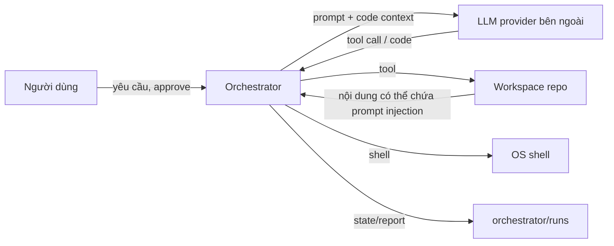

# An toàn & Threat model — Agent Team

Tài liệu mô tả mô hình tin cậy, các kiểm soát hiện có và giới hạn của orchestrator MVP. Mục tiêu là **giảm rủi ro**, không tuyên bố đây là sandbox bảo mật cấp OS.

---

## 1. Phạm vi & giả định

### Giả định

- Orchestrator chạy trên máy dev của chính người dùng, trên một repo **tin cậy**.
- Người dùng kiểm soát `.env`, API key, tài khoản git và môi trường shell.
- LLM provider là dịch vụ bên ngoài, nhận prompt/source code theo cấu hình.
- Không có multi-tenant, không có người dùng ẩn danh, không expose orchestrator ra Internet.
- Không chạy hai tiến trình orchestrator đồng thời trên cùng một run.

### Không bảo vệ trước

- Kẻ tấn công đã có quyền shell/OS trên máy.
- Repo hoặc dependency chứa mã độc chủ động.
- LLM bị compromise hoặc trả về nội dung độc hại.
- Side-channel phần cứng, malware cấp OS.
- Người dùng cố tình dùng `--yes` để duyệt mọi hành động nguy hiểm.

---

## 2. Tài sản cần bảo vệ

| Tài sản | Vị trí | Mức nhạy cảm |
|---|---|---|
| API key LLM | `LLM_API_KEY` trong env/`.env` | Cao |
| JWT secret / DB password của dự án | `.env` root | Cao |
| Source code chưa commit | working tree | Trung bình–cao |
| Git history/branch | `.git` | Cao |
| Run state/transcript | `orchestrator/runs` | Trung bình (có thể chứa code/log) |
| Báo cáo | `runs/<id>/report.md` | Trung bình |
| Cấu hình agent | `agent.config.json` | Thấp (không chứa key) |
| Tài nguyên máy | CPU/RAM/disk/network | Trung bình |

---

## 3. Ranh giới tin cậy



Điểm quan trọng:

- **LLM là bên không tin cậy về hành vi**: mọi tool call đều phải qua policy.
- **Nội dung repo là bên không tin cậy về instruction**: code/README/comment có thể chứa prompt injection.
- **Shell là bề mặt nguy hiểm nhất**: allowlist chỉ là guardrail, không phải sandbox.
- **Con người là chốt chặn cuối** trước khi commit/merge.

---

## 4. Threat model & kiểm soát

| # | Mối đe dọa | Tác động | Kiểm soát hiện có | Còn lại |
|---|---|---|---|---|
| T1 | Agent đọc `.env`/key/secret | Lộ credential | Protected paths, `.git` deny, redaction | Symlink/đường dẫn lạ; secret nằm ngoài pattern |
| T2 | Agent ghi file ngoài workspace | Ghi đè hệ thống | `classifyPath` lexical + allowedRoots | Symlink/junction; TOCTOU |
| T3 | Agent chạy lệnh phá hoại | Mất dữ liệu/repo | Deny pattern, allowlist, approval | Lệnh allowlist bị lạm dụng (`node script.js`, `npm run`, `java`) |
| T4 | Agent tự commit/push | Thay đổi lịch sử | `git push/reset/clean` deny; `add/commit` ask; không có tool commit | `--yes`/mode auto có thể duyệt |
| T5 | Deploy/publish ngoài ý muốn | Ảnh hưởng production | Deny `deploy`, `publish`, `docker rm`… | Pattern có thể bị né bằng biến thể |
| T6 | Prompt injection từ repo | Agent làm việc ngoài phạm vi | Prompt rules + policy + approval + review | LLM có thể bị thuyết phục; policy không hiểu ngữ nghĩa |
| T7 | Lộ source code cho LLM provider | Rò rỉ IP/dữ liệu | Chỉ gửi context cần thiết; không gửi `.env`; redact | Source/diff vẫn được gửi; phụ thuộc chính sách provider |
| T8 | Lộ key trong log/transcript | Credential leak | Redact pattern; không log key; config snapshot redacted | Redaction không tuyệt đối (format lạ) |
| T9 | Tốn token/chi phí | Chi phí cao | maxSteps/maxAttempts/maxCycles/timeout | Không có budget token cứng |
| T10 | Treo máy do lệnh dài | Mất thời gian | Timeout task/shell, kill process tree | Không giới hạn CPU/RAM/disk |
| T11 | Output tool quá lớn | Tràn context/chi phí | `maxToolOutputChars`, cắt output file | Tool tự sinh output lớn trước khi cắt |
| T12 | State bị sửa/xóa | Mất khả năng resume | Runs dir protected với agent; atomic write | Người dùng local có thể sửa; không có chữ ký |
| T13 | Chạy 2 process cùng run | State race/ghi đè | Không thiết kế; không lock | Không có lock đa tiến trình |
| T14 | Dependency độc hại | Mã độc | `npm install` cần approval; không auto | Người dùng có thể duyệt; lockfile không được xác minh |
| T15 | Approval bị lạm dụng | Duyệt nhầm hành động | Detail/summary rõ; grant một lần; mode deny | Người dùng có thể bấm nhầm/`--yes` |

---

## 5. Kiểm soát chi tiết

### 5.1. Path sandbox

`classifyPath`:

1. Resolve đường dẫn tuyệt đối (tương đối theo workspace).
2. Phải nằm trong workspace (`isSubPath`).
3. Không chứa segment `.git`.
4. Không khớp `protectedPaths`.
5. Ngoài `allowedRoots` → `ask`; còn lại → `allow`.

`protectedPaths` mặc định:

```text
.env, .env.local, **/.env, **/.env.local, **/.env.*.local
**/*.pem, **/*.key, **/application-secret*
docs/Token.md
.git/**, .github/**, .opencode/**, .claude/**, .specify/**
node_modules/**, target/**, dist/**
orchestrator/runs, orchestrator/runs/**
```

`fs_list`/`fs_search` bỏ qua entry bị deny; `fs_read`/`fs_write`/`fs_edit` ném `PolicyDeniedError`.

**Giới hạn:** kiểm tra là lexical, chưa `realpath`. Symlink/junction trỏ ra ngoài workspace có thể bypass nếu đã tồn tại trong repo. Không có tool tạo symlink, nhưng repo có thể chứa sẵn. Khuyến nghị hardening: resolve realpath của target và parent gần nhất trước khi so sánh.

### 5.2. Shell policy

Thứ tự quyết định:

1. **Deny** nếu rỗng, có newline, `&&`, `||`, `;`, `|`, `$()`, backtick, `cd`, `&`.
2. **Deny** nếu khớp `denyPatterns` (push, reset --hard, clean -f, branch -D, rm -rf, del /f, Remove-Item, format, shutdown, deploy, publish, docker rm, drop table, curl | sh…).
3. **Ask** nếu redirect `>`/`>>`/`<`.
4. **Ask** nếu khớp `approvalPatterns` (git add/commit/checkout/…, npm install/ci, npx, docker, pip install, mvn install).
5. **Deny** nếu gán env trước lệnh.
6. **Ask** nếu executable ngoài allowlist.
7. **Deny** với `git push|reset|clean|rebase|filter-branch|update-ref`.
8. **Ask** với `git add|commit|checkout|switch|merge|stash|restore|rm|mv|tag`.
9. Còn lại **allow**.

Allowlist mặc định gồm: `git`, `node`, `npm`, `npx`, `mvn`, `mvnw`, `mvnw.cmd`, `java`, `javac`, `docker`, `docker-compose`, `python`, `python3`, `pip`, `pytest`, `rg`, `ls`, `dir`, `cat`, `type`, `head`, `tail`, `findstr`.

**Quan trọng:** allowlist không ngăn được việc chạy code tùy ý qua runtime hợp lệ:

- `node path/to/script.js`, `npm run <script>`, `java -cp ...`, `python script.py`, `pytest`.
- Các lệnh này có thể đọc/ghi file, gọi mạng, chạy subprocess.

Vì vậy shell policy là **guardrail chống tai nạn**, không phải sandbox bảo mật. Chỉ chạy trên repo tin cậy và review script/dependency.

**Giới hạn:** regex có thể bị né bằng alias, biến thể cú pháp, executable cùng tên; không phân tích AST shell. `shell_run` chỉ cho một lệnh, nhưng bản thân lệnh có thể gọi subprocess.

### 5.3. Approval

- `allow` → chạy.
- `deny` → `PolicyDeniedError`, agent nhận output bị chặn.
- `ask`:
  - mode `deny` → chặn cứng (kể cả `--yes`).
  - `--yes`/mode `auto` → tự duyệt, ghi approval `approved`.
  - grant khớp `(taskId, tool, argsHash)` → tiêu thụ.
  - mode `gate` + TTY + interactive → hỏi `y/N`.
  - còn lại → pending + pause run + exit 2.

Grant một lần giúp:

- Không phải duyệt lại cùng hành động trong cùng task.
- Không thể tái sử dụng cho task/tool/args khác.
- Approve `all` tạo grant cho tất cả pending.

**Giới hạn:** người dùng có thể duyệt nhầm; `--yes` bỏ qua toàn bộ gate. Không có xác thực đa yếu tố.

### 5.4. Secret hygiene

- `.env` loader chỉ nạp key prefix `LLM_`, `AGENT_`, `ORCHESTRATOR_`; secret khác trong `.env` dự án không vào `process.env` của agent.
- API key primary/dự phòng chỉ nằm trong `config.provider.*ApiKey` (memory), không ghi vào `agent.config.json`; snapshot run redacts cả hai key.
- `request.md` dùng `redactedConfig` → key thành `[REDACTED]`.
- Logger/transcript/approval dùng `redactSecrets`:
  - `sk-*`, `pk-*`, `rk-*`
  - `Bearer ...`
  - `api_key=`, `secret:`, `password=`, `token=`
  - JWT `eyJ...`
- `redactDeep` che key object có tên chứa `api key|secret|password|token`.
- Tool `fs_*` chặn path secret; `git_diff` chỉ đọc diff tracked/untracked nhưng không đọc nội dung `.env` trực tiếp (untracked list có thể lộ tên file, không lộ nội dung).

**Giới hạn:** redaction dựa trên pattern, không đảm bảo 100%. Không đưa secret vào prompt; nếu agent tự đọc được qua shell ngoài policy, đó là lỗi policy/repo.

### 5.5. Không commit/push

- Không có tool `git_commit`/`git_push`.
- `shell_run` deny `git push`, `reset --hard`, `clean -f`, `rebase`, `filter-branch`, `update-ref`.
- `git add/commit` chỉ được chạy nếu được approval rõ ràng.
- Report luôn nhắc review `git status`/`git diff` trước khi commit.

Đây là kiểm soát **theo thiết kế**, không phải bảo vệ tuyệt đối nếu người dùng tự chạy lệnh sau đó.

### 5.6. Giới hạn tài nguyên

| Biến | Tác dụng | Chống |
|---|---|---|
| `maxStepsPerTask` | Số lượt LLM/tool | Loop vô hạn, chi phí |
| `maxTaskAttempts` | Số lần retry | Retry storm |
| `maxFixCycles` | Số vòng debug | Debug loop |
| `taskTimeoutMs` | Deadline task/shell | Treo máy |
| `maxToolOutputChars` | Cắt output | Tràn context |
| `maxFileWriteBytes` | Giới hạn ghi file | Ghi file khổng lồ |
| `maxContextChars` | Cắt repo profile | Prompt quá dài |

Không có giới hạn cứng CPU/RAM/disk/network; shell có thể chạy process nặng cho đến timeout.

### 5.7. Audit

- `events.jsonl`: level, event, message, timestamp; redact.
- `transcripts/<task>.jsonl`: prompt, tool call, tool output, kết quả.
- `state.json`: trạng thái, approval, grant, usage.
- `report.md`/`summary.json`: bản tóm tắt cho con người/CI.

**Giới hạn:** file audit nằm trên đĩa local, không có chữ ký/hash chain; người dùng có quyền sửa. Không phù hợp làm bằng chứng pháp lý.

---

## 6. Bằng chứng kiểm thử

- Kết quả `testsRun` do model trả về không được xem là bằng chứng. Orchestrator chỉ lưu test record do `test_run` tạo ra sau khi chạy command cấu hình và nhận exit code.
- Khi đánh giá live run, mọi suite trong `tests` phải có record thực thi; thiếu suite hoặc chưa cấu hình suite thì quality bị block, không được báo pass.
- Test suite thất bại tạo issue blocking để Debug xử lý rồi Testing chạy lại.
- Chế độ mock không chạy test thật và chỉ xác nhận luồng điều phối; report phải được đọc cùng nhãn mock.

## 7. Dữ liệu gửi cho LLM provider

Khi live mode, orchestrator gửi:

- Yêu cầu người dùng.
- Repo profile: git branch/commit, cây file, tóm tắt `pom.xml`/`package.json`, trích constitution/README, lệnh test.
- Nội dung file/tool output mà agent đọc trong quá trình làm.
- Diff, lỗi test, issue.
- Không gửi `LLM_API_KEY` trong prompt.

Rủi ro:

- Source code, tên bảng, logic nghiệp vụ, log lỗi có thể chứa dữ liệu nhạy cảm.
- Provider có thể lưu log theo chính sách của họ.
- Prompt injection trong file có thể khiến agent gửi thêm dữ liệu qua tool (nếu tool cho phép).

Khuyến nghị:

- Dùng provider có chính sách không train trên dữ liệu gửi lên.
- Không chạy live trên repo chứa dữ liệu khách hàng/PII nếu chưa được phép.
- Cân nhắc self-host LLM hoặc proxy nội bộ.
- Review prompt/transcript khi làm việc với repo nhạy cảm.

---

## 8. Prompt injection

Nguồn injection:

- Nội dung file (`README`, comment, test fixture, issue text).
- Tên file/thư mục.
- Output tool (log, test output).
- Tin nhắn `team_send` từ agent khác.

Tác động có thể:

- Agent bỏ qua task, đọc file ngoài phạm vi, chạy lệnh nguy hiểm.
- Agent làm sai acceptance nhưng báo done.
- Agent gửi dữ liệu ra ngoài (nếu có tool mạng).

Kiểm soát:

- System prompt quy định không lách policy, không đọc secret, không commit/push.
- Policy tool kiểm tra trước khi thực thi; approval cho hành động rủi ro.
- Engine tự đánh giá evidence, không tin lời agent.
- Con người review diff/report.

Giới hạn:

- LLM có thể bị thuyết phục bởi instruction trong repo.
- Policy không hiểu ngữ nghĩa; chỉ chặn pattern.
- Không có sandbox OS/network.
- Dashboard `serve` là server local **không có auth**, mặc định bind `127.0.0.1`; không mở ra Internet.

Khuyến nghị:

- Không chạy `--yes` trên repo lạ.
- Review kế hoạch (`plan`) trước khi `run`.
- Giới hạn quyền tài khoản chạy orchestrator (không dùng account admin).
- Dùng container/VM cho repo không tin cậy.
- Chỉ dùng `serve` trên máy tin cậy; không đổi `--host` thành `0.0.0.0` khi chưa có proxy/auth.

---

## 9. Checklist trước khi chạy live

- [ ] Đã review `agent.config.json` (allowlist, protected paths, test commands).
- [ ] `LLM_API_KEY` nằm trong `.env`/env, không nằm trong file tracked.
- [ ] `.env` và `orchestrator/runs` đã được gitignore.
- [ ] Working tree sạch hoặc đã commit/stash thay đổi cũ.
- [ ] Đã chạy `npm run agent -- doctor --online`.
- [ ] Dashboard (nếu dùng) chỉ bind localhost và không chứa secret trong log/report.
- [ ] Đã chạy `plan` và review DAG trước khi `run`.
- [ ] Không dùng `--yes` nếu chưa tin repo/agent.
- [ ] Có backup hoặc nhánh riêng cho thay đổi.
- [ ] Đã thống nhất phạm vi dữ liệu được gửi cho LLM provider.
- [ ] Biết cách dừng: `Ctrl+C`, kiểm tra process con nếu shell treo.
- [ ] Sau run: review `git diff`, chạy test thủ công, đọc report.

---

## 10. Khuyến nghị hardening (roadmap)

1. **Realpath check** cho path sandbox, chống symlink/junction.
2. **Sandbox OS**: container với user không root, network egress allowlist, volume chỉ workspace.
3. **Shell AST/allowlist chặt hơn**: chặn `node script.js` tùy ý hoặc yêu cầu approval cho runtime script.
4. **Budget token cứng** theo run/task; dừng khi vượt.
5. **Audit hash chain** hoặc ký report để phát hiện sửa đổi.
6. **Approval UI** hiển thị diff/patch dự kiến, không chỉ summary.
7. **Secret scanner** trước khi gửi prompt; cảnh báo PII.
8. **Network policy** cho tool HTTP (nếu thêm), domain allowlist.
9. **Lock file** cho run (tránh 2 process).
10. **Quét dependency** và yêu cầu lockfile khi `npm install`.
11. **Giới hạn quyền git**: chạy với credential chỉ đọc; không cấu hình push.
12. **Test bảo mật** cho symlink, command injection, prompt injection.

---

## 11. Báo cáo sự cố

Nếu nghi ngờ lộ secret hoặc hành vi ngoài ý muốn:

1. Dừng tiến trình orchestrator (`Ctrl+C`, kiểm tra process con).
2. Thu thập `runs/<id>/events.jsonl`, transcript, report (không gửi kèm secret).
3. Rotate API key/JWT secret nếu nghi lộ.
4. Kiểm tra `git status`, `git diff`, reflog; không tự reset nếu chưa hiểu thay đổi.
5. Xóa run/transcript nếu chứa dữ liệu nhạy cảm.
6. Ghi lại thời điểm, task, tool call, approval liên quan.
7. Cập nhật policy/protected paths/allowlist trước khi chạy lại.
